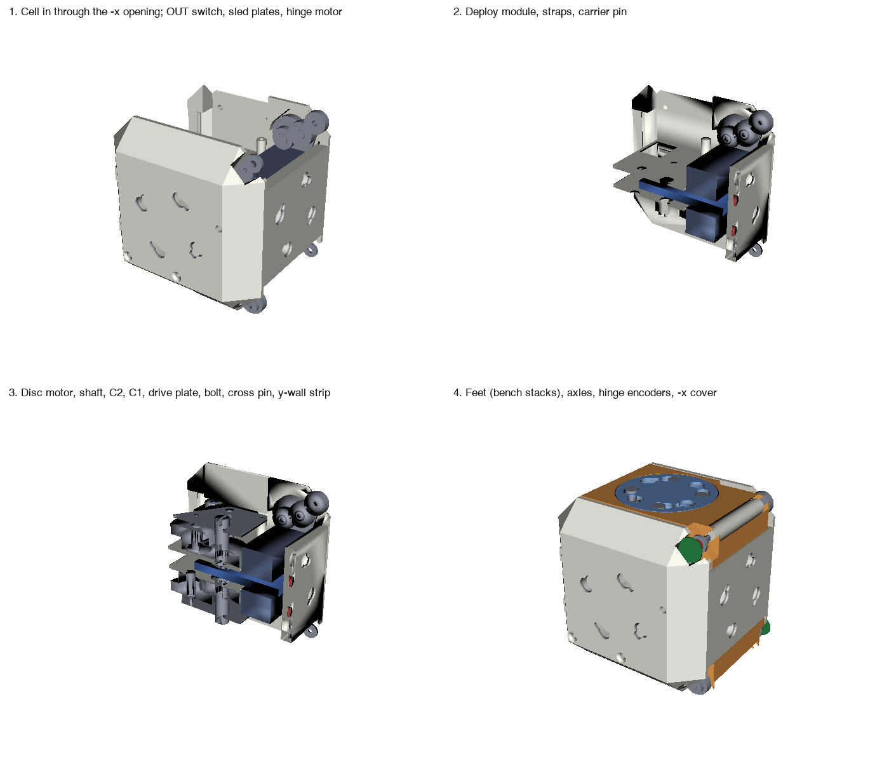
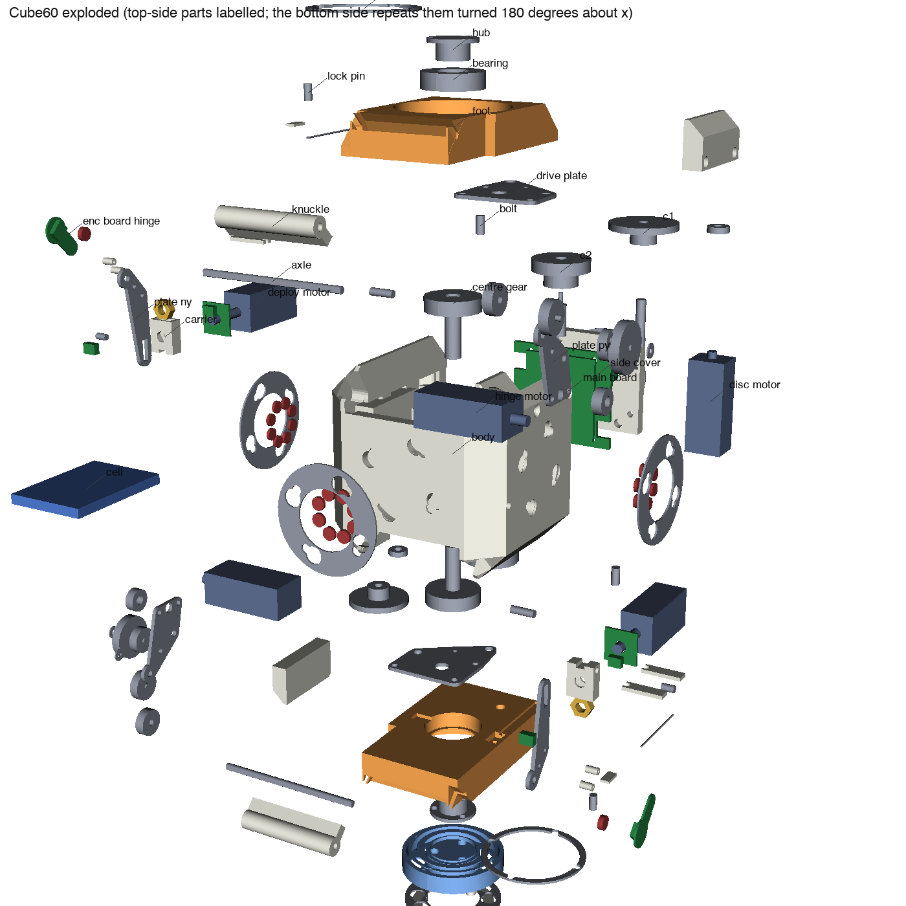

# Cube50: print, build, calibrate, test

Status: **written from the CAD; no cube has been built**, so expect fit fixes on the first one.
**Changed 2026-11-17 11:24 (+0530):** the retractable hinge's deploy drive is now a lead-screw sled per
hinge (an N20 1:150 gearmotor with an M3 screw, two end switches, firmware `bench deploy`), and the
offset coupling is gone (the cube grows to about 60 mm so the hinge train rides on the sled). The
electronics, firmware and bench test 3b are updated; section 2 follows the 60 mm CAD
(2026-11-17 16:00), whose hand-assembly check passes every step and every screw's driver path. Parts and suppliers:
BOM.md. Why each part is what it is: DESIGN.md.

## Step 0: face-magnet bench calibration (before the full parts order)

Why: the face magnets (DESIGN.md, "Face magnets") must sit in a narrow window. They must be strong
enough to pull a face shut from a 2 degree lead-in, about 0.021 N m about the hinge edge. They must
be weak enough that the hinge can peel a face off, at most 0.081 N m at 0.315 N m of hinge torque.
The sim's force model is exact for ideal magnets, but the real Br, the printed skin and the real gap
are not known. Measure them here on about 40 magnets before ordering about 1,500.

**Materials** (about 600 INR, 3 to 4 hours):

1. 50 magnets of the chosen part: NdFeB N35 disc, 4 x 1 mm, axially magnetised, nickel plated
   (Justkraft NM4X1, 3 INR each). Check with a second magnet that the poles are on the flat faces.
1. Two coupons: 20 x 20 x 3 mm PETG, each with one 4.1 mm pocket under a 1.1 mm skin.
1. Two test faces: 60 x 60 x 4 mm PETG plates, each with the 8-pocket pattern from params.json
   "magnets": radius 6.3 mm, sites at 22.5 + 45j degrees, N out at 22.5 + 90k, S out at -22.5 + 90k,
   seen from the outer face, under a 1.1 mm skin. Print a second pair with a 1.3 mm skin.
   - Print outer face down, 0.12 mm layers.
   - Pause at the top of the pockets and press the magnets in with a drop of cyanoacrylate.
   - Mark one N with a pen before the pause and check every pole with a marked reference magnet:
     a reversed magnet is the one assembly error the design does not tolerate.
1. Kitchen scale (1 g), a stack of 0.1 mm shims (printer paper, about 0.1 mm a sheet; check with the
   calipers), the printed 100 mm lever, tape, and a non-magnetic riser at least 30 mm tall (wood or a
   print) so the scale's steel stays away from the magnets.

**Procedure.** Each measurement is repeated 3 times.

1. **Single pair, pull against gap.**
   - Put one coupon on the riser on the scale, magnet up, and tare.
   - Hold the other coupon above it, coaxial and attracting, clamped to a rigid arm (a printed
     column screwed to the bench).
   - Set the gap with shims: 0, 0.2, 0.5, 1.0, 1.5 and 2.0 mm of extra air between the two skins.
   - The scale reads the pull as a loss: F = (grams lost) x 0.00981 N.
1. **Test faces, pull against gap.** Do the same with the two 60 mm plates in register, faces
   together, at the same gaps.
1. **Quarter turns and flips.** Lay one plate on the other in each of its 4 quarter turns, then with
   the top plate's other face down (its back side).
   - Facing outer faces must attract and snap into register at every quarter turn.
   - Back to front is not a cube case. Note what it does; it is not a pass criterion.
1. **Twist.** Plates in register: tape the 100 mm lever to the top plate's centre and push its end
   down on the scale to hold a 5 and then a 10 degree twist (marks on the bottom plate).
   Torque = F x 0.100 m. Let go from 15 degrees: the plate must turn back into register.
1. **Peel.** Tape-hinge the two plates along one edge (the tape line is 30 mm from the pattern
   centre, as the hinge edge is on the cube). Lift the opposite edge with the scale's hook, or a
   thread to a weight cup, at 100 mm from the hinge line, from flat. Peel torque = F x 0.100 m at the
   moment it lifts.
1. **Shear.** Plates in register on the bench: push the top plate sideways with the scale (through a
   printed pusher) and note the breakaway force. This gives the friction under the magnets' own
   clamp (mu = F_shear / F_pull); the sim assumes module_c's body friction.

**Predictions** (`nice -n 10 .venv/bin/python hardware/cube50/sim/magnet_study.py bench`, Br 1.21 T,
skin 1.1 mm):

| gap, mm | 0 | 0.2 | 0.5 | 1.0 | 1.5 | 2.0 |
| --- | --- | --- | --- | --- | --- | --- |
| single pair, N (g on the scale) | 0.264 (27) | 0.227 (23) | 0.183 (19) | 0.129 (13) | 0.094 (10) | 0.069 (7) |
| test faces, N (g) | 2.42 (247) | 2.05 (209) | 1.61 (164) | 1.08 (110) | 0.73 (74) | 0.50 (51) |

Peel from flat: 0.0726 N m, 74 g at 100 mm. Twist torque: 0.0043 N m at 5 degrees (4.4 g at
100 mm), 0.0080 N m at 10 degrees (8.1 g).

**Pass criteria.**

1. After one scale factor, the single-pair and face curves both match the predictions within 15 %
   at every gap.
1. At the design skin, after the refit (below), the peel lies between 0.053 and 0.081 N m and the
   2 degree capture torque is at least 0.021 N m.
1. The plates attract and snap into register at all 4 quarter turns, never repel at a quarter turn,
   and return to register from 15 degrees of twist.
1. Every magnet's pole is right (the reference-magnet check), and no magnet moves in its pocket after
   20 peels.

**Refit.**

1. Fit one force factor s by least squares over both curves: s = sum(F_meas x F_sim) / sum(F_sim^2).
1. Force goes with Br squared. Set params.json "magnets" "force_model" "scale" to sqrt(s); it
   multiplies Br.
1. If the shims or the skin measure differently from nominal, use the measured gaps instead; a skin
   0.1 mm thick of nominal is about 15 % of force.
1. Rerun `magnet_study.py summary` and `uv run pytest -q hardware/tests/test_cube50_magnets.py`.
1. If the peel or capture now falls outside the window, change "skin_mm" in params.json; each
   0.1 mm is about 15 % of force. At the nominal Br the window is about 1.05 to 1.3 mm. Reprint the plates at the new
   skin and repeat steps 1 to 5. Then rerun the pivot sims
   (`cube50_sim.py magnets`) before the parts order.

## Tools

Soldering iron (temperature controlled) and fine tweezers; heat-set insert tip; M2 hex and Phillips
drivers; flush cutters; needle files; pin vise with 2.0 and 3.0 mm drills and a 3 mm reamer; vernier
calipers; multimeter; crimp pliers for the SMA ferrules; cyanoacrylate and a medium threadlocker;
Kapton tape; a USB-C cable. For the bench tests: a kitchen scale (1 g), a printed 100 mm lever, a
push-pull force gauge to 50 N (or a luggage scale), a phone camera above the bench.

## 1. Print

All cube parts in **PETG** (motors and SMA wires warm the core and the disc; PLA softens at about
55 C, guess). Floor tiles in PLA. 0.4 mm nozzle. Files: `cad/print/*.stl` (STEP beside each), already
in print orientation.

| part | per cube | orientation | layer | walls / infill | supports | note |
| --- | --- | --- | --- | --- | --- | --- |
| body | 1 | on its -y face (as exported) | 0.16 mm | 4 walls, 40 % gyroid | tree supports in the cavity only | **pause** at the top of each y face's ring seat and drop in the stainless lip ring (the face magnets' pauses: step 0); the +x face stands vertical, so its seat is printed open and the ring held by four M2 countersunk screws into heat-set inserts. Press 3 M2 x 3 inserts into the cover tabs. Ream the pin presses (C1 2.96 mm, C2 3.96 mm) and the centre-shaft bushing to 5.0 mm |
| foot | 2 | outer face down | 0.12 mm | 5 walls, 50 % | none | bearing seat 19.0 mm from the inner face, test-fit first; the knuckle must slide 4.2 mm diagonally in the hinge corner without play |
| disc | 2 | face down | 0.12 mm | 100 % | none | print the skin, pause, drop the disc lip ring in, continue; press 3 M2 x 3 inserts for the hub screws |
| cam ring | 2 | flat | 0.12 mm | 100 % | none | |
| knuckle | 2 | as exported | 0.08 mm | 100 % | none | ream the bore to 2.0 mm and file its D flat to the axle's |
| carrier | 2 | as exported | 0.12 mm | 100 % | none | M3 nut pressed in; the 2 x 6 dowel hole reamed to 2.0 |
| deploy straps | 2 sets | as exported | 0.12 mm | 100 % | none | hook end and screw hole |
| lock lever | 2 | flat | 0.08 mm | 100 % | none | bellcrank for the disc lock pin |
| encoder spacers | 2 sets | as exported | 0.12 mm | 100 % | none | or 2 mm brass tube cut to 3.6 mm |
| side cover (-x) | 1 | outer face down | 0.16 mm | 4 walls, 40 % | none | pause for its lip ring and face magnets as for the body; press 4 M2 x 3 inserts for the board |
| y-wall strip | 2 | inner face down (as exported) | 0.12 mm | 100 % | none | press 2 M2 x 3 inserts; it must drop into its opening with 0.5 mm all round |
| floor tile | 2 per cube in the floor | top up | 0.2 mm | 3 walls, 20 % | none | PLA, 60 x 60 mm |

Heat-set inserts per cube: 3 (cover tabs) + 4 (side cover) + 4 (strips) + 6 (discs) + 4 (+x lip ring) = 21,
all M2 x 3 brass.

Print a test foot and a test disc first and adjust the bearing seat and hub by 0.05 mm steps. Print
time per cube is about 6.5 h on a bed-slinger at these settings (guess; BUDGET.md).

## 2. Build

The order below is the order `cad/cube50_cad.py` checks (`check_assembly`, report section "hand
assembly"). Each step's parts move along straight paths into place without touching anything
already in, and every screw's driver (3 mm shaft, 40 mm long) reaches its head.

Steps 2.2 and 2.3 are done on the top half, then repeated with the cube turned over for the bottom
half: every direction below is in the half's own frame, "down" toward the core. Do both sleds
(2.2) before either disc drive (2.3): the bottom deploy motor passes where the top disc motor will
stand.

### 2.1 Bench subassemblies

1. **Sled, each hinge.** Screw the hinge motor (1000:1 HP N20) to plate A with two M1.6 countersunk
   screws, shaft through the plate. Then fit the gears:
   - press the 12T motor gear on;
   - put the compound (25T/14T) and the 16T idler on their pins with E-clips.

   Check: turn the motor shaft by hand; the train turns freely through the 14T axle-gear position.
1. **Deploy module, each sled.** Thread the M3 nut carrier (nut pressed in) onto the FIT0577's
   screw (cut to 13 mm). Solder the IN switch board on the gearbox face round the screw.

   Check: the carrier runs the full 4.2 mm and trips the IN switch at the motor end.
1. **Disc motor, each drive.** Fit the motor encoder (custom board, see DESIGN.md) on the 298:1
   HPCB motor's back shaft and press the 12T m0.5 pinion on the front shaft.

   Check: the encoder counts in both directions.
1. **Centre shaft, each drive.** Slide the 20T m0.8 centre gear onto the 5 mm shaft (key or Loctite
   638).

   Check: the cross hole is above the gear, toward the foot.
1. **Foot stack, each foot.** Assemble on the bench:
   - press the 6800ZZ into the foot from the inner face, under the collar lip;
   - press the stainless hub into the bearing and screw the disc to the hub's flange (three M2 x 4
     into the disc's inserts);
   - fit the bond mechanism: cam ring, four pin sliders with M2.5 pan-head pins, over-centre spring,
     two SMA wires;
   - fit the lock ring under the disc rim, then the lock pin with its spring, the printed lever and
     its 32 mm SMA wire in the foot's groove;
   - put the printed knuckle in the hinge corner.

   Check: the disc turns only with the lock lever pulled, and clicks into the lock at each quarter
   turn. The bond cycles by hand and stays at either end by itself.

### 2.2 Sleds and deploy drives (each half; top, then bottom)

1. **Cell** (once, before the first half): wrap the 302535 cell in Kapton, tape the NTC to it and
   slide it in along +x through the -x opening. Check: it lies flat on the mid-plane, leads toward -x.
1. **OUT switch:** down into the foot slot, then 2.1 mm in +x into its pocket in the +x wall. Check:
   it clicks when pressed through the pocket.
1. **Plate B** (-y sled plate, with the hinge encoder's tapped stem): down, then 1.4 mm in -y into
   its 45-degree pocket. Check: it slides the full stroke diagonally, no binding.
1. **Sled subassembly** (plate A, motor, train): down, then 5.1 mm in +y so plate A enters its pocket
   and the outer gears their wall pockets. Check: the sled slides diagonally 4.2 mm in x and z by
   hand.
1. **Deploy module:** down into the cradle 2 mm short in x, then 2 mm in +x. Check: the carrier's
   dowel hole lines up with plate B's slot.
1. **Deploy straps:** down, then 2 mm in -y to hook under the -y wall's ledges. Check: they hold the
   motor down; leave the screws for the drive plate.
1. **Carrier pin** (2 x 6 dowel): push it in along +y through the access hole in the -y face, through
   plate B's slot into the carrier. Check: run the deploy motor from a 6 V supply; the sled goes out
   4.2 mm and back, and the IN and OUT switches trip.

### 2.3 Disc drives and feet (each half; top, then bottom)

1. **Disc motor** (with encoder and pinion): straight down through the y-wall strip opening into its
   bridge slot (top drive at x -17, y +19).
1. **Centre shaft and gear:** down through the bushing. Clip its E-clip under the bridge through the
   -x opening. Check: the shaft turns, no end float beyond 0.1 mm.
1. **C2 pin** (4 mm, with its 1.5 mm spigot): press into the bridge. **C2 cluster** (36T over 12T
   m0.8) onto it. Check: C2's 12T meshes the centre gear.
1. **C1 pin** (3 mm): press into the bridge. **C1 cluster** (40T over 14T) onto it. Check: C1 meshes
   the pinion and C2; turn the motor by hand through a full disc turn, no tight spots.
1. **Drive plate** (1.2 mm stainless): down over the pin tops and the strap screw holes. Screw two
   M2 x 8 self-tapping through the plate and the straps into the body, and one M2 x 6 into the
   bridge post. Check: the train still turns freely.
1. **Stow bolt:** spring, then the bolt down through its hole in the drive plate; crimp its 50 mm SMA
   wire. Check: it stands up 3 mm and pulls flush when the wire is heated for 1 s.
1. **Cross pin** (2.5 x 8 dowel): from -y at the shaft's height, then press it through the shaft.
   Check: equal ends each side.
1. **Y-wall strip:** down into its opening; two M2 x 8 countersunk screws from the y face into its
   inserts. Check: flush with the face and the chamfer, 0.5 mm gap all round.
1. **Foot stack with knuckle:** down into the foot slot, the hub over the shaft spigot and cross pin,
   the bolt into its hole. Check: the foot seats flat, nothing above the disc plane (straightedge).
1. **Hinge encoder board** on its two spacers: in through the chamfer to plate B's stem points, two
   M1.6 screws. Check: the chip faces where the axle end will be.
1. **Hinge axle** (2 mm, D flat): along -y through the +y chamfer, through plate A, the axle gear,
   the knuckle (flat into flat) and plate B. Check: the foot swings 0 to 180 degrees by hand with
   the sled deployed.
1. **Hinge encoder magnet** (4 x 1.5 mm diametric N52): glue it centred on the axle end with
   cyanoacrylate. Check: a 0.3 mm feeler passes between the magnet and the chip.

### 2.4 Close (once)

1. Plug in every motor, encoder, switch and SMA lead along the wall grooves to the main board on the
   -x cover (USB-C at y 17, z 11.5 mm).
1. **-x cover** with the main board, its lip ring and magnets: 8 mm in +x into the opening, three
   M2 x 6 countersunk screws into the body tabs. Check: USB-C reaches the cable through the cover;
   no lead is pinched.
1. Swing each foot by hand 0 to 180 degrees with its sled deployed: no lead pulls, and the bolt snaps
   in at 0.

## 3. Flash and calibrate

1. `cd hardware/cube50/firmware && pio run -e cube -t upload` (USB-C). Open the console at 921600.
1. Encoders: with each foot seated, `cal ht zero`, `cal hb zero`. Open a foot by hand to about 90
   degrees: `move ht 90` must read near 90 and hold there; if it runs away, `stop`, then `cal ht flip`.
1. Discs: turn each disc until its lock pin drops in (index 0), then `cal dt zero`, `cal db zero`.
1. IMU: the gyro bias is taken at every boot with the cube still.
1. SMA: `bench bond 0 3`: each extend and retract should finish in under 1.5 s. If they time out, raise
   `SMA_TARGET_W` by 0.05 W at a time; stop if the disc plate passes 60 C (touch or IR thermometer).

## 4. Bench tests

Every test logs JSON lines on the console; save them (`pio device monitor > logs/cube50-<test>.out`).
The order is the order of risk. **Do not build the second cube until tests 1, 2, 3b and 4 pass.**

| # | test | how | pass |
| --- | --- | --- | --- |
| 1 | bond strength | a disc face and a printed passive face in a jig (the face pattern cut from `floor_tile.step`); bond with `bench bond`. Pull normal with the gauge (10 times); hang weights on a 100 mm lever for bending (5 times each way); twist with the lever for torsion | tension >= 40 N; bending >= 3.2 N m (1.3 x the walker's 2.45, measured in sim); torsion >= 1.5 N m (1.3 x the disc's 1.13). Design values 320 N, 5.6 N m, 3.2 N m. Report the failure mode (lip ring, skin, slider, cam) |
| 1b | bond cycles | `bench bond 0 200` against the jig face | >= 199 of 200 extend and retract; then 1,000 for the spec's life figure trend |
| 2 | disc torque | `bench disc 0`: the disc pushes a 100 mm lever onto the kitchen scale; read grams at each current step | >= 1.10 N m at 1.3 A (design 1.13); no tooth damage on the steel train after 50 stalls; free speed >= 3.0 rad/s |
| 3 | back-drive, power off | with the drivers asleep, torque on a foot (lever and scale) and on a disc until it slips | foot >= 0.15 N m, disc >= 1.1 N m (the arm's 0.87 N m x 1.3); if not, a structure sags when a cube sleeps and joints need a brake |
| 3b | hinge deploy (lead-screw sled) | Per hinge, foot seated, bolt in, sled in. (a) Switches: push the sled by hand from end to end with the drivers asleep (`stop`) and read `switches` in telemetry: OUT closes only at the out end, IN only at the in end, neither between. (b) Stall current: a multimeter (or USB power meter on a bench supply at 6 V) in series with one motor lead; `sled <foot> out`, then hold the sled by hand just before the OUT switch until the motor stalls, 2 s at most. (c) `bench deploy 0 200`, then `bench deploy 1 200`; log the JSON lines. (d) Hold: with the sled out and the drivers asleep, hang 500 g (5 N) from the sled toward retract for 10 min, then 5 N toward deploy with the sled in; dial indicator or calipers on the sled. (e) Retracted, a straightedge and a 0.1 mm feeler across each disc face and the +x face over the hinge parts | **200 of 200** strokes out and **200 of 200** in per hinge, each under `DEPLOY_TIMEOUT_MS` (15 s; expect about 10 s), no `stuck`, `timeout` or `both_switches` fault (summary line: `out_ok` and `in_ok` 200, `max_out_ms` and `max_in_ms` under `timeout_ms`); **each switch reports correctly**: `out_switches_ok` and `in_switches_ok` 1 on every cycle and the hand check in (a) passes for all four switches; **holds 5 N per end with no creep over 0.1 mm** unpowered (the screw self-locks); **stall current within the limit**: at most 0.47 A (the 0.43 R chop; FIT0577 stall 420 mA +/-10 %), and no driver fault (telemetry `faults` bit 0); retracted, the feeler does not pass under the straightedge anywhere over the hinge parts. If stroke time matters more than margin, a faster screw motor is the fix (BOM.md, D1) |
| 3c | partner turn and yaw (geometry) | two cubes bonded disc to disc, one turned 4 full turns by `bench disc`; one cube standing on a disc on the tile floor turned 4 full turns | no contact noise, current within 10 % of the unloaded turn, no marks on either face |
| 4 | pivot reliability (the bar) | a 3 x 3 tile floor taped to a board; a second cube clamped beside as the neighbour. `bench pivot 1 90 100` (bottom foot bonded to a tile, body out a quarter turn and back), then 50 half turns over the clamped cube (`bench pivot 0 180 50` with the top foot bonded on its top). The overhead camera records every trial | per move: **reached >= 0.80**, **harmful <= 0.03**. Reached = ARRIVED and the cube within 1 mm and 2 degrees of its cell (camera or a printed gauge); harmful = a neighbour moved > 1 mm, anything dropped or cracked, or the cube left > 5 mm off the lattice. With 100 trials, 0 harmful bounds the rate under 0.03 at 95 % (rule of three); 1 or 2 harmful does not, so run 100 more |
| 5 | floor roll cycle | one cube, two feet: 20 cycles of the two-cell roll (DESIGN.md, motion primitives), host script or by hand with `move` and `bench bond` | 40 cells with no harmful event; time per cell |
| 6 | stow latch | `bench latch 0` 200 times; hang weights to open a seated foot | bolt seats 200 of 200; holds >= 2 N m opening |
| 7 | disc bearing tilt | 1 N m on a seated disc (lever) | tilt <= 1 degree (spec 4.9), measured with a dial indicator or the IMU of a cube bonded to it |
| 8 | battery | idle at 20 Hz telemetry until the low-battery fault; pivots per charge with `bench pivot` | idle >= 30 min (design: 2.3 h); pivots per charge about 430 (design); the cell holds 3.5 V at a 2.4 A pulse |

Results go to `hardware/cube50/bench/` (one file per test) and update the status lines in DESIGN.md.
