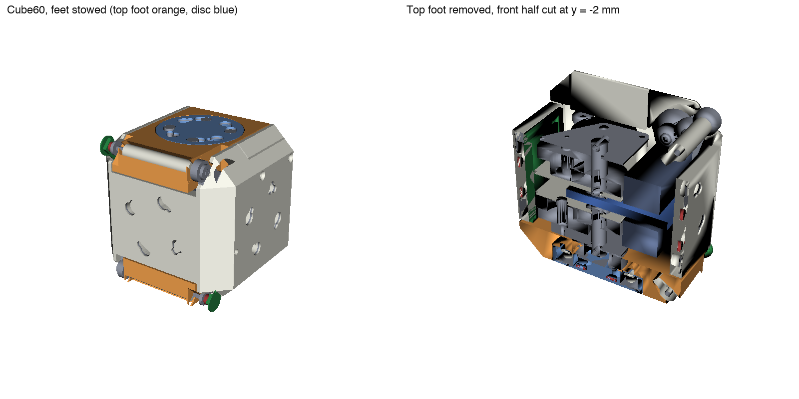
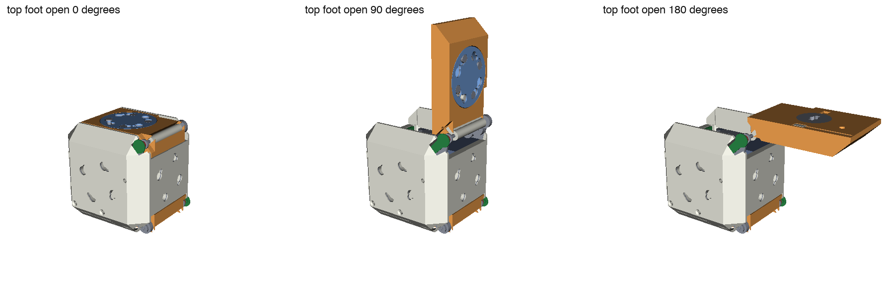
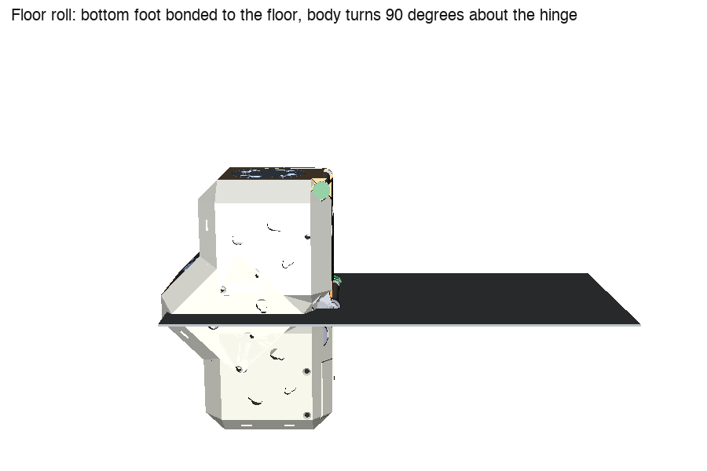

# Cube50: a 60 mm cube that pivots, turns and bonds

The directory keeps the name cube50; the cube is now 60 mm. **Nothing is built or bench-tested.**
Every robot is this one cube arranged differently (hardware/docs/MODULE_SPEC.md, hard constraint).
Numbers are marked **measured** (CAD or MuJoCo output, file named), **derived** (arithmetic shown),
**source** (a page, linked) or **guess**.

**Change note, 2026-11-17 15:59 (+0530): the full CAD is now at S = 60 mm** (it replaces the 13:37
sizing note, which moved the cube to 56 mm with the CAD still at 50). What changed, and why:

1. **Size 60 mm, chamfer 9 mm** (channel inscribed radius 6.36). The packing study found 56 mm the
   smallest size for a sled-borne hinge with the old disc drive; the stronger disc drive, the
   6800 bearing and the face magnets took the rest.
1. **The hinge is on a sled** (section "Pivot"): motor, train, axle and knuckle slide 4.2 mm in x
   and z (5.94 mm diagonal) together, driven by a FIT0577 lead-screw gearmotor. The deploy drive
   and offset coupling that blocked the 50 mm build are gone. Hinge ratio 2.08:1, 0.438 N m at
   the foot (derived).
1. **The disc drive is three stages, 14.29:1, after a 298:1 HPCB N20** (section "Face rotation"):
   cap 2.40 N m at the gearbox rating, against 1.13 N m before. A 5 mm hardened shaft drives a
   stainless hub through a 2.5 mm cross pin; the dog clutch is gone.
1. **The disc AS5600s are removed;** the disc angle comes from the motor encoder and the lock.
   The quarter-turn lock is an SMA-released spring pin into a stainless ring.
1. **6800ZZ bearing** (10 x 19 x 5), because the 6700's static capacity is under the bond's
   pull-out force (section "Face rotation").
1. **Each disc drive goes in through a removable strip of the y wall** above it, screwed with two
   M2 into heat-set inserts. Without it the first gear cluster cannot pass under the wall.
1. **Removable -x cover** carrying the main board, USB-C at (y 17, z 11.5) mm.
1. **Hand assembly is checked in CAD** (44 steps plus every screw's driver path), with a 0.8 mm
   body skin everywhere outside the intended openings.

The MuJoCo results quoted below (sims, walker, arm) are from the 50 mm design and are marked so;
the sim owner reruns them with the 60 mm figures.

Files: CAD `cad/cube50_cad.py` (parts, interference check, mass; report `cad/report.txt`), figures
`figures/`, sim check `sim/cube50_sim.py` (rows `sim/results.jsonl`), electronics
`electronics/ELECTRONICS.md`, firmware `firmware/`, parts `BOM.md` and `bom.csv`, build and tests
`ASSEMBLY.md`, cost and time `BUDGET.md`.

## Verdict first

1. **It packs and it can be put together by hand** (measured, `cad/report.txt`, 2026-11-17). At
   S = 60 mm every part fits with no overlap over 0.05 mm3 stowed, at 0, 0.5 and 1 of the sled's
   stroke, and with a foot open at 15, 45, 90, 135 and 180 degrees. The clearance checks pass:
   nothing proud when stowed, a partner turning a full turn, yaw on the tile floor, perpendicular
   hinges at a shared vertex, the deployed hinge in a pivot's channel, a 0.8 mm body skin, and a
   44-step hand assembly with every screw's driver path.
1. **Mass 323 g** (derived from CAD volumes and part masses, about half of them guesses).
1. **Torques (derived):** the hinge gives 0.438 N m at the foot against 0.134 N m of gravity plus
   0.080 N m of magnet peel (margin 2.04). The disc gives 2.40 N m at the gearbox rating, at
   0.33 rad/s.
1. **The simulated load cases are from the 50 mm, 200 g design** (walker, arm, pivots, bonds; see
   the sims below). They passed there with at least 1.3 times margin. At 60 mm and 323 g the joint
   and bond loads grow and the drive caps grew more (hinge 0.11 to 0.44 N m, disc 1.13 to 2.40 N m),
   but no sim at 60 mm has been run by this design pass; the sim owner reruns them.
1. **What it gives up** (each a change from the spec or from the grid model; read before building):
   1. **Two pivot edges, not twelve.** Each cube has two feet (the +z and -z faces) hinged on the two
      edges of its +x face. It picks a direction by turning the foot's disc while standing on it
      (yaw in place, quarter turns). The grid's move set (any edge) does not map one to one; the
      motion primitives are below.
   1. **Two active faces, four passive.** The two disc faces carry the switchable connector; the
      other four only receive it. Two cubes bond only if at least one of them presents a disc.
   1. **No power or data through faces, no face charging** (spec 5.8, 5.9, 6.3, 6.4). USB-C on the
      -x cover charges the cell; the host learns topology from the camera and the cubes' switches.
   1. **Joints hold on their gearboxes, not on a worm** (spec 4.4): a 298:1 HPCB behind 14.3:1 is
      hard to back-drive, but how hard is unknown (bench test). No joint can be set free.
   1. **Mass 323 g** against the spec's 120 g guess.
   1. **Slow disc:** 0.81 rad/s free, 0.33 rad/s at the cap. Walker gaits must be slower than the
      50 mm design's 8-12 s cycles (a sim question).
   1. **Two hinge windows in the skin** (flagged, section "Pivot"): the deployed hinge's first
      compound gear passes 0.9 mm outside the y-z chamfer, and the hinge encoder board stands in the
      y-z chamfer at the end of the hinge edge. Both are within the channel; the vertex check is
      what proves a neighbour clears them.

## The cube

| | |
| --- | --- |
| size | 60 mm, all 12 edges chamfered 9 mm (flat faces 42 mm); the two hinge edges are square-cut where the foot's hinge corner fills them (|y| <= 25) |
| feet | +z and -z faces, 11.8 mm thick, each hinged on a y-direction edge of the +x face; the hinge rides on a sled that is 4.2 mm inside the cube when stowed and on the edge line for a pivot; the foot swings 0 to 180 degrees; each carries a 34 mm disc on a 6800ZZ bearing |
| drives | 2 hinge gearmotors (Pololu HP 6 V 1000:1 N20) on the sleds, hardened m0.5 trains 2.08:1; 2 sled deploy drives (DFRobot FIT0577 lead-screw gearmotors); 2 disc gearmotors (Pololu HPCB 6 V 298:1 #3079, custom in-outline encoders) through three hardened stages 14.29:1 and a 5 mm centre shaft, cross pin and stainless hub |
| connector | on each disc: four M2.5 pin heads rise, turn under the partner's slot lips and seat (bistable cam ring, two SMA wires); every face has the four slots, their lips a 0.6 mm stainless ring under a printed skin; eight 4 x 1 mm N35 face magnets per face (magnet section) |
| disc lock | an SMA-released spring pin in the foot into one of four notches of a stainless ring under the disc rim (quarter-turn index and hold) |
| stow latch | a sprung 3 mm bolt up through the drive plate into each stowed foot, pulled by an SMA wire |
| access | a removable -x cover carries the main board (USB-C at y 17, z 11.5 mm); a removable strip of each y wall over its disc drive (two M2 into heat-set inserts) |
| electronics | ESP32-S3, DRV8833 drivers, 6 V boost, 1S 220 mAh high-rate cell, IMU, 2 hinge AS5600s, 2 disc motor encoders, switches, SMA MOSFETs (`electronics/ELECTRONICS.md` owns the details) |
| mass | 323 g (derived, `cad/report.txt`) |

## Status of every mechanism

| mechanism | status |
| --- | --- |
| body, chamfer channel, packing (60 mm) | **designed in CAD**; interference-checked stowed, over the sled stroke and at 5 foot angles: 0 overlaps over 0.05 mm3 (measured); 0.8 mm skin outside the intended openings (measured) |
| hand assembly | **checked in CAD**: 44 steps along straight paths and every screw's driver path, no collision (measured); written out in ASSEMBLY.md section 2 |
| pivot drive (sled: N20 1000:1, hardened m0.5 train 2.08:1, knuckle, axle) | **designed in CAD** with gears as tip-circle envelopes (no tooth geometry); **calculated** (margin 2.04 with magnet peel); **simulated only at 50 mm**; **needs a bench test** |
| sled deploy drive (FIT0577 lead screw, nut carrier, carrier pin into plate B, IN and OUT switches) | **designed in CAD**; stroke 4.2 mm in x and z; **needs a bench test** (holding force in a floor roll) |
| edge latch (the foot's own bond to the support during a pivot) | the disc bond; **simulated** only as an ideal latch at 50 mm |
| stow latch (SMA bolt through the drive plate) | **designed in CAD** (bolt, plate hole, foot hole); spring and SMA routing in text only; **needs a bench test** |
| face rotation (298:1 HPCB, three stages 14.29:1, 5 mm shaft, cross pin, stainless hub) | **designed in CAD**; **calculated** (cap 2.40 N m; Lewis 267-358 MPa); **simulated only at 50 mm with the 1.13 N m drive**; **needs a bench test** |
| disc lock (SMA-released spring pin, stainless notch ring) | **designed in CAD** (ring, pin, lever, SMA groove); **calculated** (about 6.3 N m before the ring bears); **needs a bench test** |
| disc motor encoder | **not designed**: a custom 10 x 12 mm two-Hall board inside the motor's outline, 5 mm long, is reserved in CAD. Pololu's kit #4761 (14.2 x 11.6 mm board) pokes 4.2 mm out of one side and fits nowhere (measured in CAD) |
| bond (bistable cam ring, J-slot bayonet, stainless lip rings) | **partly designed in CAD**: slots, lip rings (DXF), pin holes, mechanism bay, cam ring, pin sliders. **Not in CAD:** the cam's ramp profile, the J-notch seat, the over-centre spring, the SMA routing on the disc. **Calculated with guessed strengths; not simulated** (the sims weld bonds); **needs a bench test first** |
| face magnets | owned by the magnet design (section "Face magnets"); pockets in CAD |
| power, electronics, firmware | owned by `electronics/` and `firmware/`; not changed by this pass |

## Pivot: the hinge on a sled

**History, short.** All on 2026-11-17:
1. **First design:** a fixed hinge on the edge line.
   - It stood proud of the disc plane.
   - In the film agent's MuJoCo build, it blocked a partner turning on the disc, blocked yaw on a
     tile floor, and hit hinges on perpendicular edges at a shared vertex.
1. **09:30, a retractable hinge** at 50 mm. The axle and knuckle slid 4.4 mm onto the edge line,
   with the train fixed. It was blocked at the drive path: no coupling fits that carries the hinge
   torque onto a moving axle with nothing proud when stowed. Every route was listed in the
   superseded version of this section (git history).
1. **13:37, sizing note.** The packing study (`cad/packing_study.py`) put the motor, the train and
   the axle on one sled and found 56 mm the smallest size that closes.
1. **This design, at 60 mm.** The extra 4 mm went to:
   - the 298:1 disc drive with three stages;
   - the 6800 bearing;
   - the face magnets;
   - a hinge regeared to 2.08:1 for the side-neighbour drag.

Rule kept from the first change: when a foot is stowed, no hinge part stands proud of any face, and
every hinge part ends at least 5 mm short of the corners (|y| <= 25, `EDGE_END`).

**Why the hinge has to move (derived).** A pivot lands on the lattice only if it turns about the
lattice edge line itself.
- Turning about a line offset by d puts the cube off by |(I - R) d|. That is sqrt(2) d for a quarter
  turn and 2d for a half turn.
- An axle inset below the disc plane far enough to clear it (d >= 3 mm) therefore lands 4-6 mm off.
  In the second half of the floor roll it also drives the swinging foot into the floor.
- Rolling-contact hinges (two arcs and crossed straps) and four-bar hinges are exact at 0 and 180
  degrees but not at 90. For two equal arcs of radius p the error is 0.83p. A four-bar through
  three exact poses needs its fixed pivots on the edge line.
- At 180 degrees the foot lies entirely on one side of the face plane and the body on the other. So
  any part that carries the hinge load there sits on the edge line, and anything centred on the line
  stands proud.

The axle can only be on the edge line during a pivot, so it must move between the stowed and the
pivot state. The film's protruding knuckle is not an inaccuracy of the first design: a fixed hinge
on a disc face cannot do better.

**Alternative considered: hinges on the four edges parallel to the disc axis** (the edges between
two side faces, which touch no disc plane). It is clearly worse, for two reasons:
- Those edges border only side faces, so a foot there is a side face. It then needs its own active
  bond, which means two more bond mechanisms (4 more SMA wires) that do not fit.
- The hinge axes would always be parallel to the disc axis. Standing on a disc, the cube can yaw but
  not roll, since its hinges are vertical. Lying on a side, it can roll but its discs are vertical,
  so it can neither turn its heading nor get back onto a disc alone. A lone cube is confined to one
  line of cells.

Separate pivot feet on side faces fail the same way. An inset axle and rolling-contact hinges fail
the exactness argument above.

**The design** (CAD `cad/cube50_cad.py`; constants `RETRACT`, `SLIDE`, `KR`, `YA`, `YB`, `G2`, `GC`,
`GI`, `DEP_Y`, `CAR_X`, `HENC_*`):

1. **One sled per hinge.** It is everything that turns the foot:
   - the hinge motor (Pololu HP 6 V 1000:1 N20), held to plate A by two M1.6 screws;
   - the train;
   - the 2 mm ground axle with a full-length D flat;
   - two 1.2 mm laser-cut 304 end plates: plate A at y 19.9-21.1 carries the motor and the train;
     plate B at y -19.6 to -20.8 carries the pin slot and the hinge encoder board.

   The printed knuckle (r 2.8, |y| <= 15) is keyed to the axle and slides in the foot's hinge
   corner. The sled slides 4.2 mm in x and in z (5.94 mm diagonal, `RETRACT`). The plates run in
   45-degree pockets in the body's top layer, which guide them.
   - Stowed, the axle is at (25.8, 25.8). Every round part (knuckle r 2.8, axle gear tip r 4.0)
     stays 0.2 mm inside the disc plane and the +x face.
   - Deployed, the axle is on the edge line (30, 30), in the support's chamfer channel
     (inscribed radius 6.36) or the tiles' V-groove.
1. **Hinge train**, hardened steel m0.5, 2.8 mm faces, ratio (25/12) x (14/14) = **2.083**
   (derived). It runs motor 12T at (15.42, 8.10), compound 25T/14T at (13.76, 17.20), idler 16T at
   (20.50, 20.50), axle 14T (x, z in mm, stowed; measured from CAD).
   - The motor gear and the compound's 25T run outside plate A (y 21.3-24.1).
   - The 14T, the idler and the axle gear run inside it (y 16.8-19.6). The foot is pocketed there
     and swept clear of them over its 0-180 degree swing.
   - The ratio went from 1.5 to 2.08 on 2026-11-17 for the drag of a side neighbour's magnets.
1. **Deploy drive.** One DFRobot FIT0577 per sled lies along x in a printed cradle at y -14.4,
   z 9.2. It is an N20 150:1 with an M3 lead screw, cut to 13 mm; the stroke uses 11.2 mm of it.
   - An M3 nut in a printed carrier rides the screw. A 2 x 6 dowel from the carrier runs in a
     vertical slot in plate B, so the carrier's 4.2 mm in x drives the sled along its 45-degree
     pockets.
   - Two printed straps hook under ledges on the -y wall, hold the motor down, and carry the disc
     drive plate's screws.
   - An IN switch on the gearbox face and an OUT switch in the +x wall report the ends.
   - Speed: 98 rpm free x 0.5 mm lead = 0.82 mm/s, so a 4.2 mm stroke takes about 5 s (8 s at the
     rated load; derived from the FIT0577 page, BOM D1).
   - Holding: a 0.5 mm-lead M3 screw has a lead angle of 3.4 degrees, far under a friction angle
     of about 11 degrees (friction 0.2, guess). It does not back-drive, so a floor roll's push on
     the axle is held with the motor off (derived).
1. **Hinge encoder.** An AS5600 board sits on plate B's two stem points on spacers. The chip faces
   a 4 x 1.5 mm diametric N52 magnet on the axle end.
   - Running gap: 0.3 mm (`HENC_GAP`). The die is 1.8 mm from the magnet if it sits at the package
     bottom, which gives about 47 mT (derived: the on-axis field of a diametric disc, scaled by 0.7 to match the magnet agent's figures for 4 x 1 N35). The chip needs 30-90 mT.
   - The board spans y -25.0 to -24.4, exactly at the 5 mm corner rule.
   - It moves with the sled, so the gap does not change with the stroke.
   - It stands in the y-z chamfer at the end of the hinge edge (the hinge corner of the foot is
     square-cut there), so the body is open over it (flagged below).
1. **Load path in a pivot.** The foot's disc is bonded to the support. The body's weight pushes the
   axle into the knuckle and the knuckle into the foot; the plates' pockets take the axle's load
   into the body. In a floor roll the axle pushes the sled toward stowed, which the lead screw
   holds.

**Flagged: two windows in the body skin** (both allowed openings in `check_skin`, measured):

1. **First compound gear (L1, 25T).** Deployed, it reaches z 28.15 at y up to 24.1. That is
   y + z = 52.25 against 51 at the y-z chamfer: **0.88 mm outside the chamfer** (measured). The body
   is open over its path (x 11-27.5, y 20.8-25.1 in the top half). It stays inside the channel's
   inscribed radius (6.18 mm from the edge line, against 6.36).
   - Not fixable by small changes: the gear's centre, radius and y are set by the train and by
     plate A.
   - The vertex check (a neighbour at each cell round the hinge's end vertices) is what proves
     nothing hits it.
1. **Hinge encoder corner.** The board and its pocket are open through the y-z chamfer at
   x 20-27, |y| 21.5-25.8, same vertex check.

Planner rule (unchanged): two cubes must never put hinges on the same lattice edge, stowed or
deployed; a cube cannot pivot over another cube's hinge edge.

### Clearance checks (measured, `cad/report.txt`, run 2026-11-17 at 60 mm)

All pass (worst overlap 0.000 mm3 each, limit 0.05). They run on every `cad/cube50_cad.py` run:

1. **Stowed, nothing proud:** every part lies within z -30..30 mm and nothing reaches outside the
   cell into a side neighbour.
1. **Partner turning:** a second cube is bonded disc to disc on the top disc, its own hinge facing
   ours, and turned 0 to 360 degrees in 15-degree steps.
1. **Yaw:** a cube standing on its bottom disc on a 3 x 3 V-groove tile floor turns 0 to 90 degrees
   in 7.5-degree steps.
1. **Perpendicular hinge edges at a shared vertex:** our top hinge is deployed, and a neighbour sits
   in each of the 7 cells round each end vertex of that edge. Each neighbour takes every orientation
   that puts one of its hinge edges through the vertex at right angles to ours, with that hinge
   also deployed: 112 placements. This covers both skin windows (the L1 gear and the hinge encoder
   board).
1. **Pivot channel:** the deployed hinge against a support cube with the foot at 90, 135 and 180
   degrees, and against V-groove tiles bonded to the foot at 0, 45 and 90 degrees. The -y plate's
   outline was trimmed for this (its hull pushed 0.9 mm3 past the +x face, deployed).
1. **Body skin:** at least 0.8 mm under every outer surface outside the intended openings. Those
   openings are:
   - the foot slots, the -x cover opening and the strip openings;
   - the hinge edge bands;
   - the passive face pockets and the carrier-pin access holes;
   - the two flagged windows (pivot section).

   The wall grooves for the leads stop 3.5 mm short of the corners and keep 0.8 mm under the
   chamfers.
1. **Hand assembly:** 44 steps and every screw's driver path (ASSEMBLY.md section 2).

Also measured: 0 overlaps over 0.05 mm3 between the cube's own parts stowed, at 0, 0.5 and 1 of
the sled stroke, and with the top foot open at 15, 45, 90, 135 and 180 degrees.

### Simulation with knuckles (measured, `sim/results.jsonl`, `sim/run_new2.log`, 2026-11-17)

**These are the 50 mm design's results** (200 g, 0.11 N m hinge, 1.13 N m disc, 7.5 mm chamfers). They are
kept because they explain why the hinge retracts; they do not test the 60 mm cube.

Knuckle geometry is now in both MuJoCo models (`sim/cube50_sim.py`), so this conflict cannot hide:

- **Joints (module_b):** knuckles sit in a fixed child body of each module, so the neighbour contact
  exclusions do not cover them.
- **Pivots (module_c):** the cubes are 7.5 mm-chamfered convex meshes standing on V-groove tiles. The
  floor roll is latched at its edge, as the bonded foot would hold it. The mover's pivot-edge knuckle
  is deployed and collides with both the support and the floor.

| case | result |
| --- | --- |
| pivots with the deployed knuckle, 0.11 N m (floor roll, climb up, climb down) | 10/10 each; peak 0.085 N m; 0 knuckle contacts |
| same at 0.11 / 1.3 = 0.085 N m | 10/10 each, at the clip; 0 knuckle contacts |
| walker (10 s cycle, 1.13 N m cap), stowed knuckles | 45.0 cm in 4 cycles, identical to the run without knuckles; 0 knuckle contacts |
| arm, stowed knuckles | lifts 1.15 cm, carries 17.5 cm, sets down 3.8 mm from the mark, identical to the run without knuckles; 0 contacts |
| walker, old fixed knuckle (r 4.8 on the edge line) | 0.1 cm; all four leg drives at the cap for 38-41 s; 5.2 mm penetration. This reproduces the film |
| arm, old fixed knuckle | fails: block not lifted, the contact solver diverged |
| walker, first retract (parts 2.8 mm beyond the +x face) | 17.5 cm; two hubs bonded by their hinge face onto turning discs grind (0.4 mm, up to 556 N). This is why the stowed hinge now also retracts inside the +x face |

Caveats:

- module_b's lattice pitch is 52.4 mm, so a partner face stands 2.4 mm off the disc plane. That
  understates the old knuckle's overlap and would hide stowed parts that stand up to 2.4 mm proud;
  the CAD partner sweep at the true 50 mm pitch covers this.
- The joint sims used the stowed axle at x = 22.2 mm, flush with the +x face. The CAD has it at
  21.9 mm (0.3 mm clear), so the sim was the harsher case.
- In the pivot sims, only the pivot edge carries knuckle geometry.
- The original module_c model (square cubes on a flat floor) fails both climbs at 0.085 N m: the
  mover's sharp far edge drags on the third cube. With the chamfers it clears.

### Pivot torque budget

| quantity | value | basis |
| --- | --- | --- |
| largest gravity torque, own weight about an edge | 0.323 x 9.81 x 0.060 / sqrt 2 = **0.134 N m** | derived (CAD mass; worst case taken at the centre) |
| magnet peel at the start of a pivot | **0.080 N m** | from the face-magnet design (section "Face magnets") |
| gearbox limit, 1000:1 | 2.5 kg cm = 0.245 N m | source: [Pololu #1595](https://www.pololu.com/product/1595) |
| at the foot | 0.245 x 2.083 x 0.95^3 = **0.438 N m** | derived (0.95 per mesh: guess) |
| margin | 0.438 / (0.134 + 0.080) = **2.04**; gravity alone 3.26 | derived |
| speed | 31 rpm free / 2.083 = **14.9 rpm** (89 deg/s) at the foot | source, derived |
| teeth | the worst gear is the compound's 14T (r 3.5 mm): 0.245 x 0.95 x 25/12 = 0.485 N m, 139 N. Lewis (Y 0.277, 2.8 mm face, m0.5): **357 MPa**; the 16T idler (Y 0.295) 335 MPa, reversed bending; the 12T motor gear 238 MPa | derived; **through-hardened steel** (about 350-450 MPa static allowable, guess); at the gearbox rating only, so the firmware must limit the hinge current |
| simulated pivots | none at 60 mm; the 50 mm results are above | |

## Motion primitives

Each foot is a stance (standing on it, the cube can yaw by turning that foot's disc) and a hinge.

1. **Yaw:** standing on a stowed foot whose disc is bonded to a tile, the disc motor turns the body
   in quarter turns. Torque: floor friction under the 42 mm face, about 0.5 x 3.2 N x 18 mm = 0.029 N m
   (derived, friction 0.5 guess).
1. **Floor roll, two cells a cycle (lone cube):** standing on foot A with A's hinge leading: (1) pivot
   90 degrees, the body lies in the next cell, A flat on the old tile; (2) release A, swing it home;
   (3) foot B is now on the leading face with its hinge at the floor: swing B out 90 degrees onto the
   next tile and bond it; (4) pivot 90 degrees onto B; (5) yaw 180 degrees on B so its hinge leads.
   About 20 s for two cells at 60 mm (derived from 1 s hinge turns, two 5 s sled strokes per pivot, about 1.5 s per SMA action and 0.33 rad/s yaw; guesses), against
   2.7 s a cell for the simulated hinge cube.
1. **Climb onto a neighbour:** standing on A beside the neighbour, with the top foot B's hinge on
   the shared top edge: swing B 180 degrees to lie on the neighbour's top and bond it, release A, then
   turn the hinge back to 0: the body swings up and over and lands on B on the neighbour's top
   (half turn about the edge; gravity torque as above). Down is the reverse.
1. **Wall climb (concave):** the same with 90 degrees, B bonded to the wall face above.
1. **Joints:** a stowed foot's disc is a twist joint (walker legs, arm joints); a foot's hinge is a
   bend joint of up to 0.44 N m (the hinge must be deployed, so not under a bonded partner).

## Face rotation: the disc

**Bearing.** The disc (34 mm, PETG) is screwed to a turned 303 stainless hub (three M2 x 4 A2) that
is pressed into a **6800ZZ** (10 x 19 x 5). The bearing is pressed into the foot from its inner face,
and a 0.6 mm collar lip of the foot over the outer race stops a bond's pull from drawing it out.

The 6700 (10 x 15 x 4) of the 50 mm design is too small. A bond's bending moment at the 60 mm
lever is resisted by about 340-410 N of axial pull-out at 5.6-6.7 N m (derived, bond section). The
6700's static rating C0 is 0.435 kN; at about 0.5 C0 axial it carries about 0.22 kN, which
fails. The 6800 has C0 0.65-0.93 kN by maker, so its axial static safety s0 is about 1.0-1.35
(derived). **Buy NSK or NTN** (the upper end); a no-name 6800 is marginal.

**Drive** (CAD `disc_drive()`, constants `DT`, `DT_M`, `C1_XY`, `C2_XY`, `SHAFT_*`, `HUB`). The motor
cannot ride in the foot: an N20 is 25.6 mm long and the foot is 11.8 mm thick. So it stands in the
core:
- **Motor:** Pololu HPCB 6 V 298:1 with extended back shaft (#3079), at (-17, 19) against the +y wall
  for the top disc, the bottom drive turned over.
- **Three hardened steel stages** on two fixed pins pressed into a bridge shelf (z 3.3-4.6):

  | stage | gears | module | face | z (mm) |
  | --- | --- | --- | --- | --- |
  | 1 | 12T pinion to 40T (cluster C1 at (-5.67, 12.62)) | 0.5 | 2.0 | 14.0-16.0 |
  | 2 | C1's 14T to 36T (cluster C2 at (-12.61, 2.22)) | 0.5 | 4.0 | 9.7-13.7 |
  | 3 | C2's 12T to the 20T centre gear | 0.8 | 4.5 | 4.9-9.4 |

  The ratio is (40/12)(36/14)(20/12) = **14.29** (derived).
- **Drive plate:** 1.2 mm 304, over the train at z 16.4-17.6. It holds the pin tops and guides the
  stow bolt, and is screwed to the deploy straps and a post on the bridge. The C2 pin is 4 mm, with
  a 1.5 mm spigot through the plate past C1's 40T.
- **Centre shaft:** a 5 mm hardened shaft carries the centre gear. It is held under the bridge by an
  E-clip and cross-drilled for a 2.5 x 8 mm hardened dowel.
  - Stowed, the shaft's spigot enters the hub's bore and the dowel the hub's slot. That is the
    clutch: when the foot opens, the hub lifts off the dowel.
  - Loads (derived): dowel bearing on the hub 78 MPa at the cap; shaft torsion 98 MPa, about
    200 MPa at the cross hole. Both are steel.

The disc AS5600s are removed (2026-11-17). The disc angle comes from the motor encoder, counted
through the train, and is re-zeroed at every lock engagement.

**Motor encoder: open part.** Pololu's magnetic encoder kit #4761 (source: Pololu) adds about 5 mm
behind the motor. Its board is 14.2 x 11.6 mm against the motor's 12 x 10 mm, so it stands 4.2 mm
out of one side. In every orientation that pokes into the board, the cell or the other drive
(measured, CAD placement search). The HPCB motor is not in its listed compatibility either.
- The CAD reserves a **custom 10 x 12 x 5 mm board inside the motor's outline**: two Hall sensors
  round a 6-pole disc on the back shaft, as on #4761.
- The motor with its encoder spans z -16.9 to 13.7 (measured).
- Owned by `electronics/`; not designed.

**Disc lock** (CAD `lock_parts()`): a 2.5 mm hardened dowel in the foot at r 15.6 mm is sprung up
into one of four notches of a 0.8 mm 304 stainless ring under the disc rim (r 15.0-17.0). That
locks the disc at every quarter turn, stowed or open. A 32 mm 0.15 mm Flexinol wire pulls a printed
bellcrank to draw the pin 1.1 mm and free the disc for a turn.
- It is engaged by default, so a foot bonded to a support cannot spin under the body, and a stowed
  disc holds a joint unpowered.
- Holding: about **6.3 N m** before the ring's notch bears (derived), 2.6 times the drive's cap.
- Before a pivot, or to release, the disc is turned to the next notch.

### Rotation torque budget

| quantity | value | basis |
| --- | --- | --- |
| gearbox rating, 298:1 HPCB | 2 kg cm = 0.196 N m (Pololu's limit for all ratios of this gearbox) | source: [Pololu #3079](https://www.pololu.com/product/3079) |
| motor at 6 V | 110 rpm free, 0.15 A free; stall 3.4 kg cm = 0.333 N m at 1.5 A | source, same page |
| train | 14.29, efficiency 0.95^3 = 0.857 | derived (0.95 per mesh: guess) |
| current limit | DRV8833 chop at **0.94 A** = the current at the gearbox rating on the 6 V line: 0.15 + 1.35 x 0.196 / 0.333 | derived |
| at the disc | **2.40 N m** cap (gearbox rating) at 0.33 rad/s; 2.2 N m at 0.37 rad/s and 0.88 A; 4.08 N m theoretical stall (not allowed) | derived, `cad/report.txt` |
| free speed at the disc | 110 / 14.29 = 7.7 rpm = **0.81 rad/s** | derived |
| teeth, Lewis at the cap | stage 1 **267 MPa**, stage 2 **320**, stage 3 **358** | derived (`lewis()` in the CAD); **through-hardened steel** (about 350-450 MPa static allowable, guess) |
| walker, arm | the 50 mm design's sims needed 0.87-0.98 N m with 200 g modules and 3.3 rad/s free; at 323 g the joint loads grow by about 1.6 x and the drive is 0.81 rad/s free | not simulated at 60 mm |

## Bond: the disc connector

Pattern (every face, active or passive): four bayonet slots at 67.5 + 90k degrees on a 12 mm radius,
seen from outside the face. The disc adds four pins at 22.5 + 90k. Two faces meet mirrored, so a
partner's angle phi lands on alpha - phi for the relative quarter turn alpha in {0, 90, 180, 270}; a pin
at 22.5 + 90k lands on 90m - 22.5 - 90k = 67.5 + 90(m - k - 1), always a slot, for every alpha (derived,
and tested in `hardware/tests/test_cube50.py`). The pattern needs no gender and works at all four
quarter turns (spec 3.2, 5.2).

The slot lips are not PETG: each face carries a 0.6 mm stainless ring (32.4 mm OD, laser cut from
`cad/bought/lip_ring_passive.dxf`, or `lip_ring_disc.dxf` with the pin arcs) dropped into its seat at a
print pause and covered by a 0.6 mm printed skin. The partner's pin heads (M2.5 pan head, 4.5 mm) hook
under steel; our own pin sliders bear up against our own ring, so the whole tension path is steel
to steel except the screw threads.

Sequence (bond): pins rise 2.6 mm out of the disc (cam ramp), turn 12 degrees under the slot lips,
then drop into a seat at the end of each slot, which pulls the faces together and blocks
reverse torsion (a J-slot). Release runs it backward. The cam ring is bistable: an over-centre spring
holds it fully in or fully out with no power (spec 5.3, 9.4). Two SMA wires (0.15 mm, about 85 mm,
routed round the ring) turn it either way; a switch at each end tells the firmware when to stop
heating (spec 5.7, for the active side only).

Release from either side (spec 5.6): only the disc's owner can open a bond. If the owner is dead the
bond stays; a passive face cannot let go.

### Bond strength at 60 mm (guesses until the pull test)

| quantity | value | basis |
| --- | --- | --- |
| per pin | **80 N** design value, kept from the 50 mm design. Each pin is an M2.5 pan-head screw through its slider (an M2.5 thin nut); the slider bears on its own lip ring; the stainless lip and the ring's skin are stronger than 80 N (50 mm figures: 1 kN and 1.2 kN) | guess |
| tension, 4 pins | **320 N** | derived from the guess |
| bending about the face's contact edge (21 mm from the centre, where the chamfer starts) | pins at 21 + 12 cos(theta): 32.1, 25.6, 16.4, 9.9 mm, sum 84 mm: 80 N x 0.084 m = **6.7 N m** | derived from the guess |
| torsion (pin stems on the slot seats) | 80 N x 4 x 0.012 m = **3.84 N m** | derived from the guess |
| pull-out on the disc bearing | the bending moment over the pins' lever: about 340-410 N at 5.6-6.7 N m | derived; sets the 6800 bearing (disc section) |
| needed (spec 5.5) | tension 15 N, shear 10 N, bending 0.8 N m, torsion 0.8 N m | source: MODULE_SPEC.md |
| needed, 50 mm sims (200 g) | walker bond moment 2.45 N m, arm 1.92 N m (50 ms averages) | measured at 50 mm, `sim/results.jsonl`; not rerun at 60 mm |
| torsion against the drive | 3.84 / 2.40 (disc cap) = **1.6**; the disc lock holds about 6.3 N m, so the bond is the weaker link in torsion | derived |
| bending margin | 6.7 / 2.45 = 2.7 against the 50 mm loads; the 60 mm loads are not simulated (mass up 1.6 x, lever up 1.2 x: about 4.7 N m if they scale, margin about 1.4, guess) | derived, guess |

## Face magnets

**Added 2026-11-17, for S = 60 mm, chamfer 9.** All six faces of every cube carry fixed magnets, in
the same layout, next to the bayonet. They pull a face into register and hold light loads; the
bayonet carries the heavy loads. Nothing switches. A face is released M-Blocks style: the hinge
torque peels it off about an edge. Code and data:

1. `sim/magnets.py`: the model.
1. `sim/magnet_study.py`: the bounds, cogging, AS5600 and bench numbers, written to
   `sim/magnet_results.jsonl`.
1. `sim/cube50_sim.py magnets`: the pivots, written to `sim/results.jsonl` as `pivot_magnets_*`.
1. `hardware/tests/test_cube50_magnets.py`: the proof.
1. params.json `"magnets"`: every parameter. A layout change is one edit there.

**Chosen point:** NdFeB N35 discs, 4 x 1 mm, axially magnetised. Eight per face at radius 6.3 mm,
delta 22.5 degrees, under a 1.1 mm printed skin: 48 per cube. Justkraft NM4X1, 3 INR each, 300 INR
per 100 (source, listing of 2026-11-17).

### Layout: chiral pinwheel

Seen from outside a face, the site at +delta + 90k has N out and the site at -delta + 90k has S out.
Two faces meet through a reflection, so a partner's site at phi lands on alpha - phi for the quarter
turn alpha. A site at +delta + 90k lands on -delta + 90m, and the reverse. **Every site therefore
faces the opposite pole at all four quarter turns, on every face pair**, and the firmware never
tracks polarity (derived). It needs delta off 0 and 45 degrees: a site on a mirror line of the
square would meet itself.

At delta = 22.5 the sites fall 45 degrees apart with alternating poles. The reflection maps index j
to alpha/45 - 1 - j, which flips parity, so the rule holds there too. The disc's pins sit on the
same angles (22.5 + 90k), but at r 12, outside the magnets.

On a disc face the magnets ride on the disc. At every quarter turn of the disc the pattern equals
the fixed one, so discs must stop at quarter turns, as they already do before a pivot.

**Proof (measured, test).** Whole cubes are modelled (48 face magnets and the 4 encoder magnets each).
The test covers:

1. All 6 x 6 face pairs at 4 quarter turns (144 cases): attractive (2.4 N), no lateral force, no tilt
   torque. A 1 degree twist and a 0.3 mm offset in each direction both restore.
1. A disc against each of the 6 faces, at every disc angle in 1 degree steps, at 4 quarter turns.
1. Disc on disc: one disc in 7.5 degree steps, the other swept in 2 degree steps.
1. In every disc sweep the only stable twist angles are quarter turns, 90 degrees apart, and all
   attract. There is no false register.
1. The force model agrees with magpylib.getFT within 0.5 %.

186 cases pass, about 7 minutes on the CPU.

At other twists the pair is not attractive. The normal force falls from -2.42 N in register to 0
at 22.5 degrees and to **+2.42 N (repulsion) at 45 degrees** (measured, sim). That matters only
when a disc turns under an unbonded face (see Cogging).

### Force model

`magnets.py` uses magnetic surface charges on each target magnet. These are its end caps, or the
curved side for the diametric encoder magnets. The source field is magpylib's closed-form
cylinder field, which is exact outside the source. Force and torque are the quadrature of sigma B
over the target's surfaces.

1. Against magpylib.getFT it is within 0.5 % at contact (measured, test).
1. Pairs further apart than 45 mm are dropped; that is under 0.2 % (measured, test).
1. No dipole shortcut is used anywhere.
1. The MuJoCo hook adds the wrench of every cube pair within 1.8 S to `xfrc_applied` before every
   `mj_step`. A pair whose relative pose moved less than 0.5 um since its last evaluation reuses
   that value. Pairs welded by a bond are skipped, since their load is internal.

### Which faces touch in each pivot (derived from Motion primitives)

| primitive | at the start | at the end |
| --- | --- | --- |
| yaw | no pivot; the disc turns (cogging below) | |
| floor roll, pivots 1 and 4 | foot A on its tile: no magnetic contact (tiles carry no magnets or steel) | +x face or foot B on a tile: none |
| foot swings (roll steps 2, 3) | the foot leaves a tile: none | |
| climb up | **+x face on the neighbour (peel about the shared top edge)**, plus each **side face (+-y) against a side neighbour, sliding in its own plane** about the hinge axis | the body closes onto its own foot B (internal); B's disc face was captured on the neighbour's top when B swung over |
| climb down | top-layer side neighbours (slide); the body opens from its own foot B (internal; the sim's module_c model has the body peel off the support's top, same torque) | +x face lands on the neighbour's side (capture; gravity closes); bottom-layer side neighbours slide in; then B peels off when it swings home (foot hinge, no body weight) |
| wall climb | as climb up (peel + slides) | B captured on the wall cube above; the body closes onto B |

A neighbour behind the mover (on -x) is ruled out by geometry: the mover's back face moves into it.
So the worst start is **one face peeling plus two side faces sliding**.

### The two bounds

| quantity | value | basis |
| --- | --- | --- |
| gravity, m g S / sqrt 2 | 0.31 x 9.81 x 0.060 / sqrt 2 = **0.129 N m** | derived (0.31 kg: scaled guess) |
| hinge torque | **0.315 N m** (0.245 x 1.5 x 0.95^2) | the task's figure; **BOM.md's 18T-18T-18T is 1:1 = 0.221 N m**, which leaves 0.018 N m for peel and fails the capture bound |
| weak enough: peel allowance, 0.315 / 1.5 - 0.129 | **0.081 N m** | derived |
| strong enough: lead-in | **2 degree** wedge at the hinge: 1.05 mm at the face centre, 1.27 mm at the far magnets. 0.5 mm lateral each way and 1.5 degree twist | guess: gearbox and train backlash, sled and axle play, disc lock-pin play. The pivot itself is lattice-exact, and 0.5 mm is well inside the 9 mm chamfer and the magnets' restoring range |
| strong enough: load | the foot closing upward onto a face: 2 x 0.035 kg x 9.81 x 0.030 m = **0.0206 N m** | foot mass a guess (the 50 mm foot parts, 21 g, scaled). In the listed primitives gravity never opens a landing face, so this is the "light load" case |
| capture torque at the lead-in, chosen point | **0.0263 N m** at Br 1.17 (1.28 x), 0.0281 at 1.21, 0.0296 at 1.24 | measured, sim |
| in terms of peel, the capture bound needs | peel >= **0.053 N m** | derived (capture to peel ratio of this geometry) |
| peel window | **0.053 to 0.081 N m** | derived |
| peel, chosen point | **0.0679 / 0.0726 / 0.0762 N m** at Br 1.17 / 1.21 / 1.24 | measured, sim |
| required hinge, one face peeling | 1.5 x (0.129 + 0.076) = **0.308 N m**; pivot margin 0.315 / (0.129 + 0.0726) = **1.56** | derived |
| at a 3 degree lead-in | capture 0.0191 N m at Br 1.17 (0.93 x): **fails**. The window nearly closes: capture at 3 degrees is at best 0.28 of the peel (4 x 1 mm), against 0.254 needed, so only a skin near 1.05 mm meets both at nominal Br, and not across the N35 Br spread | measured, sim |
| skin as the trim knob | each 0.1 mm of skin is about 15 % of force; the window is about 1.05 to 1.3 mm at nominal Br | measured, sim |

**With side neighbours, no size meets both bounds** (derived).

1. The slide peaks at 3 degrees: 0.056 N m per side face (measured, sim).
1. Peel plus two slides peaks at 0.135 N m at 2.5 degrees (measured, sim). The weakest magnets that
   still capture give 0.099.
1. The hinge then needs 1.5 x (0.129 + 0.099) = 0.342 N m, more than 0.315.
1. With the chosen magnets it needs **0.40 N m** without friction, and about **0.42 N m** with the
   friction the magnets' clamp adds (1.5 x the 0.278 N m peak simulated below). That is a hinge
   ratio of about 1.9:1 instead of 1.5:1, about 20 % slower.
1. The alternative is a planner rule: never pivot while a side face touches a neighbour.

The user chooses between these. Both are decision items.

### Pivots with magnets (measured, `sim/results.jsonl`, 2026-11-17)

Setup:

1. 60 mm chamfered cubes, 0.31 kg, on 60 mm V-groove tiles, with deployed knuckles scaled by 1.2.
1. 10 seeds per case.
1. While a pivot runs, the mover keeps all its contacts. module_c switches mover-support contacts off,
   and with magnets that let a landing face be pulled 2.5 mm into the support (24 N), so it was
   changed.
1. "Bonded" side neighbours are welded to the world; "free" ones are lone cubes on the tiles, 0.5 mm
   away.

| case | hinge 0.315 N m | hinge 0.21 N m (= 0.315 / 1.5) | peak hinge torque | peak magnetic torque on the mover about the pivot axis (resisting) | neighbours |
| --- | --- | --- | --- | --- | --- |
| no magnets | roll, climb up, climb down 10/10 each | | 0.152 N m | | |
| magnets, no side neighbours | 10/10 each | **10/10 each** | 0.173 N m | 0.069 (climb up), 0.073 (climb down) N m | support and the cube beside it moved 0.5-0.6 mm (the 0.5 mm placement gap closing), tilt under 0.1 degree |
| magnets, side neighbours bonded | 10/10 each | climb up **0/10** (stalls, returns) | 0.256 N m | 0.120 N m | moved 0.7 mm (the gap closing, weld compliance), tilt 0.3 degree |
| magnets, side neighbours free | 10/10 each | climb up **0/10** | 0.278 N m | 0.118 N m | **dragged 1.4 mm** beyond the closed gap and tilted 1.0 degree. Not flipped, but each pivot past a free neighbour shifts it about 1.4 mm |

Every run's landing error is under 0.01 mm. No knuckle contacts. Floor rolls see no magnets
(non-magnetic tiles).

### Cogging on the disc drive (measured, sim)

1. **Disc turning with a bonded partner** (yaw on a cube, a walker joint): **0.0004 N m**, 0.04 % of
   the 1.13 N m cap. Only the other faces of the turning cube act on the disc's magnets, and they
   are far away.
1. **Disc turning under an unbonded face** (a cube resting on the disc, or a disc turned while a
   neighbour touches it): **0.0126 N m** on the drive (1.1 % of the cap). The neighbour feels
   +-2.42 N normal and 0.012 N m twist.
   - On top, it is repelled by 2.42 N of its own 3.0 N weight at 45 degrees.
   - **Beside a vertical disc face it would be shoved off** (2.42 N against 1.5 N of floor friction).
   - Rule: do not turn a disc more than 20 degrees (where the force reaches zero) under an unbonded
     face.

### AS5600 encoders

**Tolerance (source).** The chip needs 30 to 90 mT of Bz on its 1 mm Hall circle (AS5600 datasheet,
magnetic characteristics:
[ams-OSRAM via Infineon mirror](https://www.infineon.com/assets/row/public/documents/24/49/infineon-as5600-datasheet-en.pdf),
[AN000271](https://www.mouser.com/pdfDocs/AnglePositionOnAxis_AN000271_2-00.pdf)). The datasheet
gives no stray-field immunity figure.

**Error model.** The angle comes from the first harmonic of Bz round the Hall circle, so a uniform
external Bz cancels and a gradient does not. The error bound is asin(stray first harmonic / signal
first harmonic). That the AS5600's Hall array works this way is an assumption from its datasheet
description, not a measured fact.

**Disc AS5600s removed (2026-11-17).** The discs now use the motor encoder plus the lock index. The
crosstalk between the two disc encoders found earlier (5.8 mT, up to 6.6 degrees, when they sat
back to back on the z axis) is gone with them.

**Hinge AS5600s at the CAD position.** The magnet is HENC_MAG, 4 x 1 mm diametric (N35 assumed), on
the axle end at y -22.1..-21.1. The die is 5.9 mm inside the -y face plane, on the axle line:
(25.8, -24.1, 25.8) mm stowed and (30, -24.1, 30) deployed. The bottom hinge is mirrored.
`sim/hinge_encoder_check.py` writes the `hinge_as5600` row in `magnet_results.jsonl`.

| hinge AS5600 | value | error |
| --- | --- | --- |
| signal, die at the board face (2.0 mm from the magnet) | **25.6 mT: below the 30 mT minimum**. 39 mT at 1.5 mm, 58 mT at 1.0 mm; N52 gives x1.2 | |
| from the cube's own 48 face magnets and the other hinge's magnet | 0.0002 mT | 0.001 degree |
| neighbours sliding past during pivots about either hinge (side neighbours at their lattice cells, 0 to 180 degrees) | 0.0004 mT at most | 0.001 degree |
| bound: one neighbour face slid to any point over the -y face | 1.05 mT | 2.4 degrees |

Lattice neighbours never reach the bound: their magnets stay at least 34 mm from a die at the
face's corner. So stray field is not a problem at this position. The signal is the issue: set the
die 1.0 to 1.5 mm from the magnet (all measured, sim).

### Magnet-safe materials (derived; ferromagnetic parts are not modelled)

1. The lip rings must be **austenitic stainless (304 or 316)**, not 430. A ferritic ring under the
   skin at r 9.1-13.5 would pull on every face magnet and on the partner's.
1. Pins, ring screws and nuts in **A2 (304) stainless**, inserts in brass. The steel pin heads
   enter the partner's slots about 5 mm from its magnets.
1. Steel parts that stay steel are not in the force model: the hardened gears, the 6700 bearing,
   the centre shaft, the motor cans and their magnets. They are at least 10 mm from any face magnet
   inside the cube, which is far from a 4 x 1 mm magnet. The bench test with a built face is the
   check.
1. Assembly: one reversed magnet breaks the polarity rule. Check every pocket with a marked
   reference magnet (ASSEMBLY.md step 0 does the same on the test faces).

### Not modelled

1. Soft-magnetic parts (above), recoil permeability (mu_r about 1.05, taken as 1), temperature and
   the magnets' Br spread inside a batch.
1. The real backlash (the 2 degree lead-in is a guess) and the foot's mass (0.035 kg guess). The
   60 mm mass (0.31 kg) and inertia are scaled guesses; the sim's inertia is a uniform cube's.
1. Discs are rigid with the body in the pivot sims (locked at a quarter turn, as designed).
1. Friction is module_c's body friction, not measured PETG on PETG. Step 0 measures it.
1. The magnets of the floor tiles: the tiles have none. A tile with the face pattern would add one
   face's peel to floor-roll pivot 4, the same as the climb's peel.
1. The encoder positions (scaled guesses) and the hinge train (0.315 N m assumed, BOM says 1:1).

## Stow latch

A stowed foot is held by its hinge axle on one edge and by a 3 mm steel bolt at (-19.8, -6.8) mm.
A spring pushes the bolt up through its hole in the disc drive's plate into a hole in the foot
(z 14.9 to 21.2 mm). The body's separate bolt guide is gone; the plate guides the bolt. Opening
moment capacity: a 3 mm steel bolt in PETG bears about 350 N, at about 50 mm from the hinge edge
that is about 17 N m (derived with 40 MPa bearing, guess).

An SMA wire pulls the bolt down for 1.2 s when the foot opens. The bolt's chamfer lets the returning
foot push it aside, and it snaps in. A switch reports the foot seated. The spring and the SMA
routing are text only.

## Power budget

| item | value | basis |
| --- | --- | --- |
| cell | 1S 302535, about 220 mAh, 0.81 Wh; 85 % usable = 2.5 kJ | guess (generic pouch size), derived |
| idle (radio listening, 20 Hz telemetry) | about 0.3 W | guess (ESP32-S3 with ESP-NOW receive on, about 80 mA) |
| hinge turn, quarter, lifting own weight (60 mm) | motor torque (0.134 + 0.080) / (2.083 x 0.857) = 0.120 N m; current 0.1 + 1.5 x 0.120 / 1.18 = 0.25 A at 6 V = 1.5 W, / 0.9 boost = 1.7 W for 1.0 s = **1.7 J**; plus two sled strokes, about 0.2 A x 6 V x 5 s x 2 / 0.9 = **13 J** | derived (stall figures as in the 50 mm row; FIT0577 185 mA at its rated load, BOM D1) |
| SMA action | 0.55 W x about 1 s = **0.55 J**; bolt 0.55 W x 1.2 s = 0.66 J | derived; contraction time is a guess |
| one pivot with bond, release and stow (60 mm) | 0.55 + 0.66 + 1.7 + 0.55 + 0.5 (foot swing home) + 13 (sled out and back) + 0.3 W x 15 s idle = **21.5 J** | derived; the sled strokes dominate (upper bound: 0.2 A assumed, the screw's real load is unknown) |
| pivots per charge | 2,500 / 21.5 = **about 115** | derived |
| idle per charge | 2,500 / 0.3 = 8,300 s = **2.3 h** (spec 6.1 asks 30 min) | derived |
| walking (two legs on one module at about 4 W each) | 2,500 J / 8 W = **5 min** | derived, guess 4 W per leg motor |
| peak | one disc motor at its 0.94 A chop, 5.6 W at 6 V, / 0.9 boost / 3.7 V: **1.7 A from the cell** (7.7C) | derived; the firmware lets one disc and one hinge draw high current at a time; the cell must be high-rate (open part) |

## Mass budget (`cad/report.txt`, 60 mm, 2026-11-17)

Printed parts are CAD volumes x PETG density x a solid fraction (guess); steel and stainless parts
are CAD volumes x density (derived); bought parts are catalogue or guessed masses.

| group | g |
| --- | --- |
| printed (PETG): body 36.0, two feet 29.4, -x cover 4.7, two strips 4.2, two discs 5.6, knuckles 2.2, cam rings 0.8, carriers, straps, levers, spacers 0.6 | 83.5 |
| motors: 2 x 10.5 hinge (1000:1 HP), 2 x 9.5 disc (298:1 HPCB), 2 x 10.0 deploy (FIT0577) | 60.0 (guesses; Pololu does not list mass) |
| gears, hardened steel: disc trains 53.8 (C1 13.6, C2 23.4, centre gears 15.8, pinions 1.0); hinge trains 14.8 | 68.6 |
| steel and stainless: drive plates 11.6, hubs 8.0, sled plates 7.4, centre shafts 5.2, bond pins 4.2, C1 and C2 pins 3.8, lock rings 2.4, axles 1.8, nuts 0.8, cross pins, E-clips, bolts, carrier pins, lock pins 2.4 | 47.6 |
| two 6800ZZ bearings | 16.0 |
| six stainless lip rings (two disc rings 3.2, four face rings 8.8) | 12.0 |
| magnets: 48 face magnets 4.8, two hinge encoder magnets (4 x 1.5 N52) 0.2 | 5.0 |
| cell 7.0 (guess), main board 7.0 (guess), switches and small boards 4.0, lock SMA 0.2 | 18.2 |
| wiring and FFCs 4.0, SMA and springs 1.5, screws and inserts 4.0, ring PCBs and contacts 2.0, lock parts 0.6 (all guesses) | 12.1 |
| **total** | **322.7** (`cad/report.txt`); centre of mass (-0.1, 0.0, 0.0) mm; inertia 1.40e-4, 1.54e-4, 1.28e-4 kg m2 about the centre |

## What the bench must show before a second cube is built

See ASSEMBLY.md, "Bench tests". In order: the bond (pull and torsion on two printed faces, 200 cycles),
the pivot (one cube, foot bonded to a tile clamped to the bench, 100 quarter turns and 50 half turns,
reached >= 0.80 and harmful <= 0.03), the gearbox back-drive torque of both motors, the disc stall
torque and 50 stalls on the steel train, the disc bearing's tilt under 1 N m.

## Not modelled or not designed

1. Text only: the cam ring's ramp profile and the slot's J-notch seat, the over-centre spring, the
   SMA routing on the disc, the stow bolt's spring, and the lead loops round the hinge.
1. **The disc motor encoder board** (custom, 10 x 12 x 5 mm inside the motor's outline): reserved in
   CAD, not designed (`electronics/`).
1. The +x face's lip ring is screwed into an open seat (the body prints on its -y face), with four
   M2 screws into inserts; the seat and the screws are not drawn.
1. Gear teeth: the gears are drawn as tip cylinders. Not modelled either: backlash (about 0.1 mm per
   mesh, guess) and printed-part compliance. FDM bore positions are about +-0.2 mm (guess); the pin
   presses and the bushing are reamed, and the stage centre distances depend on them.
1. The floor: tiles (`cad/print/floor_tile.stl`, PLA, V-grooves at the edges) laid edge to edge and
   taped to a board.
1. Two cubes whose hinge edges fall on the same lattice edge would put two hinges in one channel. The
   planner must keep hinge edges apart.
1. The firmware's pivot sequence must deploy the sled before a pivot and stow it after
   (`firmware/`, owned there).
1. Thermal: SMA wires heat the disc plate and the lock lever; PETG softens at about 80 C (guess).
1. **The MuJoCo sims are at 50 mm** (200 g, the old drives). The sim owner reruns them at 60 mm.

## Plain floor (sim, 2026-11-17)

**Why.** A cube should move on any flat ground, not only on bonded tiles. In the pitch film's MuJoCo
build (`~/beebot-pitch/hook2/test_plain.py`, 60 mm spec, contact friction only, no floor bond) the
tile-era primitives fail on a plain floor: STAND leaves the cube lying (the swung foot lifts back off
the floor; holding it down needs 3-5 N, which only a bond gives), and YAW turns the disc 90 degrees but
the body 0 degrees (the disc spins on the floor and the foot plate holds the body). ROLL alone already
worked (pivot-edge slip 1.45 mm at friction 0.6, 2.08 mm at 0.4).

**What changed.**

1. **Hinge range 0 to 240 degrees** (was 0 to 180). The push-over STAND opens the back foot to 235
   degrees against the floor. Clearance from the foot plate to the core, measured in the sim model: 15.7 mm
   at 180 degrees, 9.9 mm at 220 and 6.6 mm at 240. The sled, knuckles and hinge drive have to allow
   this range. This is not checked in CAD.
1. **Floor-side knuckle segments belong to the foot leaf** (or are a free sleeve), so under a pivot
   they stay put on the floor instead of rolling with the body. If they roll, a knuckle of radius
   2.8 mm moves the hinge line 4.4 mm per quarter turn, and the pivot foot slips 4.6 mm at friction 0.6
   and 9.5 mm at 0.4.
1. **Rubber pad on each disc face: 34 mm across, 0.5 mm proud of the foot plate, friction about 1.0.**
   It carries the standing cube, so the disc grips the floor and the body turns over it. Measured: a
   quarter turn of 90.0 degrees, 0.0 mm pad slip, disc torque 0.004 N m. Open questions:
   - Under a side load a cube on its pad tilts up to about 2 degrees (0.5 mm over 13 mm) before the
     face edge lands.
   - A face-to-face bond gets a 0.5-1.0 mm gap. The bond's alignment window is -1.5 to 2.5 mm.
1. **Every floor pivot hands the body from one foot to the other.** No floor bond is used. The tilt
   comes from the cube's IMU.
   - **ROLL.** Before the pivot the top foot opens to 180 degrees. The bottom foot then drives the
     body to 45 degrees. Past that point the top foot's plate is on the floor and lowers the body over
     3 s; its plate is pressed down, so contact holds. The bottom foot holds still, so its plate lifts
     off.
   - **STAND (push-over).** The same lying-to-standing step as before, with the same cell and the same
     foot. Both feet open flat. The back foot opens on to 235 degrees and tips the body over the front
     knuckle. The front foot keeps its plate level (IMU plus hinge encoder). At 55 degrees of tilt the
     front foot lowers the body over 2 s.
   - **YAW.** On the pad.

**Measured** (`hook2/out/plain_lone_mu0.6.json` and `mu0.4.json`): one lone cube does ROLL, STAND
and YAW in sequence. The roll's pivot is twice as slow as on tiles (5.4 s).

| | friction 0.6 | friction 0.4 | limit |
| --- | --- | --- | --- |
| pivot-foot slip, roll / stand | 0.11 / 1.54 mm | 0.10 / 1.61 mm | about 2 mm |
| landing error from the cell, roll / stand | 0.6 / 2.3 mm | 0.9 / 0.6 mm | - |
| yaw turn, pad slip | 90.0 deg, 0.0 mm | 90.0 deg, 0.0 mm | - |
| hinge peak, instant / 50 ms mean | 0.245 / 0.242 N m | 0.243 / 0.241 N m | 0.292 (0.438 / 1.5) |
| disc peak | 0.004 N m | 0.004 N m | 1.6 |

The planner's ROLL and STAND outcomes (cells, foot, orientation) are unchanged, so lattice plans
carry over. Only the executor changes.
