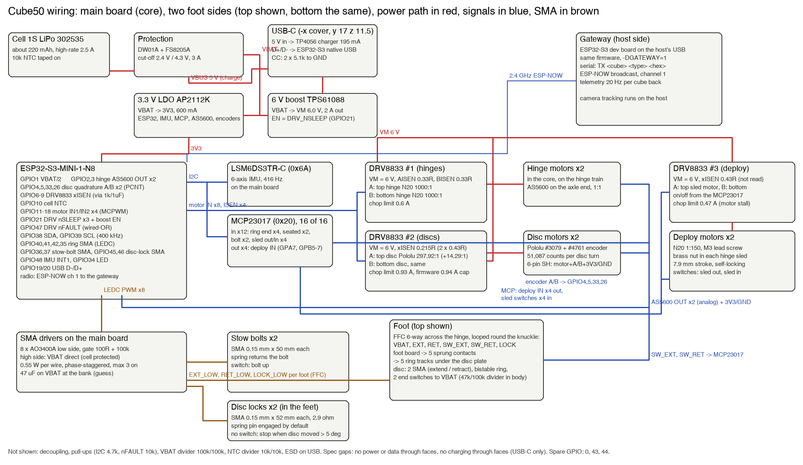

# Cube50 electronics

**Changed 2026-11-17 (60 mm redesign):** the folder is still `cube50`; the cube is 60 mm. Disc drives are Pololu
#3079 gearmotors with #4761 quadrature encoders (the disc AS5600s are gone), each foot has a quarter-turn lock
released by a 0.15 mm SMA wire (8 SMA channels, was 6), the disc current cap is 0.94 A, the hinge AS5600s
read the axle end 1:1, the main board rides on the removable -x cover, and the connector list is below.
Earlier: **2026-11-17 11:24 (+0530)**, the hinge deploy drive (a third DRV8833 for the two sled motors, four sled
switches on the MCP23017, which is full).

Status: **designed as a netlist and a block diagram; no KiCad schematic or layout yet.** Nothing is
built. The netlist (`netlist.csv`) is the authority; `wiring.png` (drawn by `diagram.py`) is its
summary. The firmware's pin map (`../firmware/include/pins.h`) matches the table below.

How to read the numbers: **source** has a link, **derived** is computed here from sources, **guess** is
neither. Where a number is from memory it says so.

## Boards

| board | where | carries | size |
| --- | --- | --- | --- |
| main | vertical on the removable -x cover, components toward +x | ESP32-S3-MINI-1-N8, 3 x DRV8833, TPS61088 6 V boost, AP2112K 3.3 V, TP4056 charger, DW01A + FS8205A protection, MCP23017, LSM6DS3TR-C, 8 x AO3400A, USB-C at y 17, z 11.5 mm | 33 x 26 mm, 4-layer, parts on one side (the 50 mm CAD envelope was 33 x 26 x 3.2 mm; not checked against the 60 mm cover. Two more AO3400A, four 0805 sense resistors in place of two, a 47 uF cap and two more SH headers add about 25 mm2: guess) |
| hinge encoder x2 | outside the hinge train in the +y (top) and -y (bottom) wall | AS5600 facing a 4 x 1 mm diametric magnet on the axle end (DESIGN.md "AS5600 encoders") | 8 x 8 mm |
| disc encoder x2 | soldered to the back of each disc motor (Pololu #4761) | two Hall sensors and a 6-pole magnet disc on the extended back shaft; 6-pin JST-SH side-entry connector that also carries the motor | part of the motor |
| foot board x2 | the foot's floor under the disc | 5 sprung contacts onto the disc's ring tracks, the lock wire's two pads, FFC socket | ring, 26 mm OD (50 mm CAD figure) |
| disc ring PCB x2 | glued under each disc plate | 5 concentric tracks (r 10.6 to 12.9 mm), wires to the 2 SMA and 2 end switches on the disc | 0.6 mm thick ring |

Removed: the two shaft encoder boards (AS5600 under each centre shaft). The cover is removable, so every cable
that leaves the main board ends in a connector (list below); no joint sits inside a closed space.

JLCPCB assembles the main board (economic PCBA); the small boards carry one SOIC-8 or nothing
and are hand-soldered.

## Power path

1. **Cell:** one 1S LiPo pouch, 302535 (3 x 25 x 35 mm), about 220 mAh, high-rate (>= 2.5 A). A 2S
   pack does not fit the core, and two 1S cells in series did not either (CAD, 50 mm).
1. **Protection:** DW01A + FS8205A in the negative lead (over-discharge 2.4 V, over-charge 4.3 V,
   over-current about 3 A). Firmware stops at 3.45 V (finish the move) and sleeps at 3.30 V.
1. **Charging:** TP4056 from the USB-C port at about 195 mA (PROG 6.2k, 0.9C). The port is on the -x cover at
   y 17, z 11.5 mm, off-centre (DESIGN.md). **Spec gap:** spec 6.4 asks for charging through any face; this
   cube charges only by cable.
1. **Motor supply:** TPS61088 boost to 6.0 V (the motors' rated voltage), enabled with the drivers. See
   "Current and power budget" for the peak: one disc motor at its 0.94 A cap is about 1.9 A from a 3.3 V cell
   (derived), 2.31 A with the logic. Firmware lets only one disc turn at a time (`DiscTurn`), a hinge only
   while its sled is out, and a deploy motor only while no disc or hinge is moving. The cell must be rated
   for 2.5 A (11C at 220 mAh); a stock cell of this size and rate is still to be found (BOM E4). With an
   ordinary 1-2C pouch the boost's input limit would have to be about 0.4 A, which leaves the disc about
   0.25 N m: the arm would not lift.
1. **Logic:** AP2112K-3.3 from VBAT (600 mA; ESP32-S3 radio peaks about 350 mA, guess from typical
   ESP32 figures). The two disc encoders and two hinge AS5600 run from 3V3.
1. **Deploy motors:** from VM (6 V) through DRV8833 #3, on or off, never both at once (the pivot
   sequence deploys one hinge). Budget per motor, from the DFRobot FIT0577 listing: 24 mA free,
   185 mA at its 550 g cm rated load, 420 mA (+/-10 %) stalled; the sled needs about 20 g cm
   (derived), so it runs near 30-60 mA. Stalled at the 0.47 A chop limit it draws 2.8 W, 0.95 A from a 3.3 V cell
   (derived), and only until the deploy timeout (`DEPLOY_TIMEOUT_MS`, 9 s: a stroke takes about 6 s, 1.5 times
   margin).
1. **SMA (8 wires):** straight from VBAT, low-side AO3400A per wire, LEDC PWM at 1 kHz, duty set each 5 ms for
   0.55 W per wire (`config.h`). Ring wires switch off when their end switch closes or after 2 s; bolt wires
   after their hold time; a lock wire when the disc has moved 5 degrees, or after 2 s (a fault). At most 3 wires
   heat at once, each on its own phase of the 1 ms period, so their pulses do not stack (see the budget).

## Pin assignment (ESP32-S3-MINI-1-N8)

| GPIO | net | use |
| --- | --- | --- |
| 1 | VBAT_SENSE | ADC, VBAT/2 |
| 2, 3 | ENC_HT, ENC_HB | AS5600 analog out, hinge axles (1:1 with the foot) |
| 4, 5 | ENC_DT_A, ENC_DT_B | top disc quadrature A, B (PCNT unit 0), freed by the disc AS5600 |
| 6, 7 | HT_ISEN, HB_ISEN | DRV8833 #1 sense (0.33 R), RC filtered |
| 8, 9 | DT_ISEN, DB_ISEN | DRV8833 #2 sense (0.215 R = 2 x 0.43 R), RC filtered |
| 10 | NTC | cell temperature |
| 11-14 | HT_IN1/2, HB_IN1/2 | MCPWM unit 0, hinge motors |
| 15-18 | DT_IN1/2, DB_IN1/2 | MCPWM unit 1, disc motors |
| 19, 20 | USB D-, D+ | native USB (flashing, bench console) |
| 21 | DRV_NSLEEP | all three bridges + boost enable |
| 26 | ENC_DB_B | bottom disc quadrature B (PCNT unit 1) |
| 33 | ENC_DB_A | bottom disc quadrature A |
| 34 | LED | status |
| 35, 36, 37 | SMA_B_RET, SMA_BOLT_T, SMA_BOLT_B | LEDC |
| 38, 39 | SDA, SCL | IMU 0x6A, MCP23017 0x20 |
| 40, 41, 42 | SMA_T_EXT, SMA_T_RET, SMA_B_EXT | LEDC |
| 45, 46 | SMA_LOCK_T, SMA_LOCK_B | LEDC, disc lock wires (strapping pins, see below) |
| 47 | DRV_NFAULT | wired-OR, pull-up |
| 48 | IMU_INT1 | data ready |
| 0, 43, 44 | (free) | spare |

### Pin budget

1. **Pins on the module:** 39 GPIOs are brought out (GPIO 0-21, 26, 33-42, 43, 44, 45-48; **source:** ESP32-S3-MINI-1
   datasheet v1.7, table 3-1, [espressif.com datasheet](https://www.espressif.com/sites/default/files/documentation/esp32-s3-mini-1_mini-1u_datasheet_en.pdf)).
   36 are used, 3 are free (0, 43, 44). IO26 is available on the -N8, not on the -N4R2 (table note b); IO33-IO37
   are available on both. The old note "GPIO 33-37 free on the N8, from memory" is now checked, and IO33 and
   IO26 were free, which is what lets everything fit.
1. **What the redesign needs:** 4 encoder inputs and 2 SMA gates = 6 pins. Freed by the disc AS5600s: 2 (GPIO 4,
   5). Free already: 43, 44. That is 4, two short, so the other two come from IO33 and IO26 (encoders) and the
   two SMA gates take the strapping pins 45 and 46 (the only pins left that tolerate a gate pull-down).
1. **Strapping pins (source: same datasheet, table 4-1):**
   - GPIO0 (weak pull-up, low at reset = download mode): spare, not used. An encoder output must never go
     there: it is pulled low by the sensor.
   - GPIO3 (floating at reset, JTAG source select): carries the bottom hinge AS5600's analog output, unchanged. The
     strap only matters if the JTAG eFuses are burned (from memory: check before layout).
   - GPIO45 (weak pull-down, low = 3.3 V flash) and GPIO46 (weak pull-down, low = normal boot): the lock wires'
     gates, each with the 100 k pull-down, so both read low at reset and the wires stay off while booting.
     Keep the pull-downs on the board.
   - GPIO19, 20 are USB; GPIO43, 44 are UART0 (ROM boot messages on 43). They stay spare: an encoder there
     would fight the boot log.
1. **Peripherals:**
   - PCNT: 2 units of the S3's 4 (2 channels each, from memory, ESP32-S3 TRM), one unit per disc, both channels for
     4x counting. PCNT inputs go through the GPIO matrix, so any GPIO works.
   - LEDC: all 8 of the S3's low-speed channels are now used for SMA. A ninth wire needs a different driver.
   - MCPWM: unchanged (4 timers).
1. **MCP23017 (0x20): still 16 of 16.** The redesign adds no inputs or outputs there (the lock has no switch; the
   disc angle comes from the encoder). Spare after this: GPIO 0, 43, 44, or a second MCP23017 at 0x21.

## MCP23017 (0x20): 16 of 16 pins

GPA7 and GPB7 are **output-only** on the MCP23017 since datasheet revision D (DS20001952D, June
2022; Microchip says using them as inputs can corrupt SDA). The four deploy outputs take both.

| pin | dir | net | use |
| --- | --- | --- | --- |
| GPA0-3 | in, no pull-up, not inverted | SW_EXT_T, SW_RET_T, SW_EXT_B, SW_RET_B | disc ring end switches, close to VBAT through the 47k/100k divider |
| GPA4, GPA5 | in, pull-up, inverted | STOW_T, STOW_B | foot seated |
| GPA6 | in, pull-up, inverted | BOLT_T | top stow bolt up |
| GPA7 | out | DEP_T_IN1 | DRV8833 #3 AIN1 |
| GPB0 | in, pull-up, inverted | BOLT_B | bottom stow bolt up |
| GPB1, GPB2 | in, pull-up, inverted | SLED_OUT_T, SLED_IN_T | top sled at its out end, at its in end |
| GPB3, GPB4 | in, pull-up, inverted | SLED_OUT_B, SLED_IN_B | bottom sled |
| GPB5 | out | DEP_T_IN2 | DRV8833 #3 AIN2 |
| GPB6, GPB7 | out | DEP_B_IN1, DEP_B_IN2 | DRV8833 #3 BIN1, BIN2 |

The deploy outputs are high-Z after reset, which leaves both bridges coasting (the DRV8833's inputs have
internal pull-downs). All MCP traffic stays in the 200 Hz control task (two-byte reads of GPIOA/B, a
two-byte OLAT write only when a deploy output changes).

## Motor drivers

Three DRV8833 (dual H-bridge, 2.7-10.8 V, 1.5 A RMS per bridge, source: TI datasheet from memory),
all on VM = 6 V, one shared nSLEEP (GPIO 21, with the boost enable) and one wired-OR nFAULT. Sense
resistors set the hardware chop limit (I_trip = 0.2 V / R):

| bridge | R | I_trip | firmware cap | basis |
| --- | --- | --- | --- | --- |
| hinges | 0.33 R | 0.61 A | 0.40 A | unchanged; 0.40 A is Pololu's 2.5 kg cm limit on the 1000:1 gearbox |
| discs | **0.215 R** (two 0.43 R 0805 in parallel) | **0.93 A** | **0.94 A** | derived: 0.2 / 0.94 = 0.213 R; the nearest build from the 0.43 R already bought for the deploy bridge. The cap is 1 % above the trip: the trip voltage has a tolerance (DRV8833 datasheet, from memory about +/-20 %), so the hardware chop is the real ceiling, between about 0.78 and 1.1 A |
| deploy | 0.43 R | 0.47 A | none (not read) | the FIT0577's stall current, 420 mA +/-10 % |

Each 0.43 R in the disc pair dissipates 0.465 A squared x 0.43 R = 0.09 W at the chop current (derived), under
an 0805's 0.125 W (guess: check the part; a 1206 is a drop-in if the margin is too thin).

**Disc drive (derived from the Pololu pages):** Pololu #3079 is the 297.92:1 HPCB 6 V micro metal gearmotor
with an extended back shaft (source: [pololu.com/product/3079](https://www.pololu.com/product/3079): 110 rpm and 150 mA
no load, 3.4 kg cm and 1.5 A stall extrapolated, at 6 V). External ratio 14.29:1. Free speed at the disc is
110 / 14.29 = 7.7 rpm = **0.80 rad/s** (46 deg/s). Torque at the disc is 3.04 N m per ampere above the 0.15 A
no-load current (2.40 N m at 0.94 A, with an efficiency of 0.86, a guess matching the hinge train's three
meshes at 0.95).

**Disc encoder:** Pololu #4761 (source: [pololu.com/product/4761](https://www.pololu.com/product/4761)) gives
**12 counts per motor revolution counting both edges of both channels**, and "to compute the counts per revolution of
the gearbox output shaft, multiply the gear ratio by 12". So the 12 is already the 4x figure:
12 x 297.92 x 14.29 = **51,087 counts per disc turn** (0.00705 deg per count; derived). The task text's
"12 x 4 x 298 x 14.29 = 51,100" has the right product but reads as if the 4 were extra: the PCNT counts all four
edges and the firmware multiplies by 12, not by 48. The outputs are driven low or pulled to Vcc through 10 k on the
encoder board (same page), so they run from 3V3 straight into a GPIO. At free speed the motor turns 32,800 rpm and
the encoder makes 6,550 counts per second, a count every 150 us (derived).

Position comes from the count; there is no absolute reference. The quarter-turn lock is the index: the
firmware re-sets the angle to the exact quarter each time the pin seats (`DiscTurn`, `../firmware/src/disc.cpp`),
which drops any counting drift. After a power cycle the angle starts at 0, on whichever quarter the pin
holds (which quarter is not known: an open item, see the report).

**Disc turn (firmware, `../firmware/src/disc.cpp`):** heat the lock wire, start turning (current limited to 0.60 A
until the pin clears, guess), stop heating once the disc has moved 5 degrees, turn to the target quarter, wait
0.4 s (guess) for the spring to seat the pin, then push 0.3 N m worth of current (0.25 A, derived) in the
direction of the turn for 0.4 s: the encoder must move less than 1 degree (guess: it sits on the motor side, so
gear backlash counts) or the turn reports a lock fault. A quarter turn takes 3 s at the 30 deg/s reference
(65 % of free speed, guess) plus about 1 s for release, seat and verify.

**Hinge:** the AS5600 now reads a magnet on the axle end directly, so the foot angle is the encoder angle (1:1;
`HINGE_GEAR = 1.0`). The train is 2.083:1 (12:25 then 14:16:14), 0.438 N m at the foot and 14.9 rpm free
(89 deg/s). Travel (-2 to 182 degrees) is under 360, so the angle is absolute at power-up.

Deploy drive (one per hinge): an N20 gearmotor with an M3 lead screw (DFRobot FIT0577: 6 V, 98 rpm
free, 1:150, 1000 g cm locking torque) turns in a brass M3 nut in the sled. A stroke takes about 6 s
(task spec); check the screw's lead on arrival: 7.9 mm at 0.5 mm per turn would be 9.7 s at free speed, and
`DEPLOY_TIMEOUT_MS` (9 s) then has to go up. Holding 5 N needs 5 x 0.5 mm / (2 pi x 0.2) =
2.0 mN m = 20 g cm at the screw (derived, 20 % screw efficiency assumed). The 0.098 N m locking torque
gives about 250 N of thrust (derived), far above need, and the screw's 3.4 degree lead angle is under
its friction angle, so it holds unpowered at both ends (self-locking). The deploy bridges' sense voltages are
not read; the chop limit, the end switches and the timeout bound them, and bench test 3b measures their stall
current with a meter in series.

## Current and power budget

Cell: 1S, 220 mAh, rated 2.5 A, firmware peak budget 2.4 A. All figures below are at VBAT = 3.3 V (the sleep
threshold, the worst case for current) with a 90 % boost (guess), logic 0.41 A (ESP32 radio peak 0.35 A, guess;
IMU, MCP, AS5600 and encoders about 0.06 A, guess). Motor current from the cell = I_motor x 6 V / 0.9 / VBAT (derived).

| case | motor | SMA (average, peak pulse) | logic | cell average | cell peak |
| --- | --- | --- | --- | --- | --- |
| disc turn, TURN phase at the 0.94 A cap | 1.90 A | none | 0.41 A | **2.31 A** | 2.31 A |
| disc turn, release phase (0.60 A limit, lock wire on) | 1.21 A | 0.17 A, 1.14 A | 0.41 A | 1.79 A | 2.76 A for about 0.15 ms |
| lock hold test (0.25 A) | 0.51 A | none | 0.41 A | 0.92 A | 0.92 A |
| hinge swing at its 0.40 A limit (0.6 A chop: 1.21 A) | 0.81 A | none | 0.41 A | 1.22 A (1.62 A) | same |
| sled stroke stalled at the 0.47 A chop | 0.95 A | none | 0.41 A | 1.36 A | 1.36 A |
| three SMA wires (the cap), nothing moving | none | 0.50 A, 1.18 A | 0.41 A | 0.91 A | 1.59 A |

Wire figures at 3.3 V: ring 4.7 ohm (85 mm): duty 0.24, 0.17 A average, 0.70 A pulse; bolt 2.8 ohm (50 mm): duty
0.14, 1.18 A pulse; lock 2.9 ohm (52 mm at 55 ohm/m, 2.86 ohm derived; source for the 55 ohm/m: the task spec): duty
0.15, 1.14 A pulse; each averages 0.55 W / 3.3 V = 0.17 A. All derived.

Results:

1. **The worst sustained load is the disc turn at the cap: 2.31 A, inside the 2.4 A budget by 4 %.** The disc cap fell
   from 1.30 A to 0.94 A, so the motor draw fell from 2.63 A to 1.90 A at 3.3 V; the old 2.4 A figure was motor only and
   assumed 3.6 V. With the logic the margin is thin. A loaded cell sags (internal resistance 0.15 to 0.3 ohm, guess), and at
   3.0 V under load the same turn is 2.1 + 0.41 = 2.5 A, which is over budget. This is the first thing to measure on
   the bench (turn at the cap, log VBAT).
1. **Eight SMA channels would break the cell if they pulsed together.** All eight LEDC channels start their pulse at
   count 0 by default: 4 ring + 2 bolt + 2 lock wires pulse 4 x 0.70 + 2 x 1.18 + 2 x 1.14 = 7.5 A at 3.3 V,
   over the DW01A's 3 A trip and the cell's 2.5 A (derived). That was already true of the six-channel design, which nothing
   in the firmware prevented. The firmware now (1) lets at most 3 wires heat at once (`SMA_MAX_ACTIVE`) and
   (2) gives each its own phase slot 256 counts apart (duty cap 0.40, so a pulse never wraps), so with duties
   under 0.25 the pulses never overlap and the SMA peak is one wire, 1.18 A. Below about 3.1 V the ring wires' duty
   passes 0.25 and two pulses overlap by up to 15 % of the period (peak about 2 A): acceptable, and under the
   firmware's 3.3 V sleep it cannot occur.
1. **The release phase is the worst pulse:** 1.21 A (motor, limited to 0.60 A on purpose) + 0.41 A + 1.14 A = 2.76 A for
   about 0.15 ms each millisecond, above the 2.4 A budget. A 47 uF ceramic across VBAT at the MOSFET bank (new; guess,
   sized for X5R derating: the droop itself is 1.1 A x 0.15 ms / 47 uF = 3.5 mV, derived, so 22 uF would also do on that
   count) supplies the pulse, so the cell sees nearly the average.
1. **Energy per quarter turn:** about 4 s of motor at roughly 0.3 A average (guess) from VM is 0.45 mAh from the cell,
   plus the lock wire (1 s, 0.17 A, 0.05 mAh): about 0.5 mAh, 0.2 % of the 220 mAh cell (derived, guess inputs).
1. **Lock heat:** 0.55 W for under 1 s in a 0.15 mm wire is inside Flexinol's usual 0.41 A at 1 s
   (Dynalloy's Flexinol 0.006 in table, from memory, not checked), though the lock wire's 0.44 A
   RMS (0.55 W in 2.86 ohm, derived) is 7 % over it. The release phase stops heating at 5 degrees, normally under a second.

## Sensing

1. Two AS5600 magnetic encoders on the hinge axles (analog output, absolute angle at power-up, spec 4.5), each
   reading a 4 x 1 mm diametric magnet on the axle end: foot angle 1:1. (Was four AS5600; the two on the disc
   centre shafts are removed, which also removes their 5.8 mT crosstalk, DESIGN.md.)
1. Two Pololu #4761 quadrature encoders on the disc motors' back shafts, counted by PCNT: relative position,
   re-indexed to the quarter turn each time the disc lock seats. The lock itself has no switch; the encoder
   test (0.3 N m push, no motion) is how the firmware verifies it.
1. LSM6DS3TR-C 6-axis IMU on the main board: roll and pitch by complementary filter, yaw by gyro (the
   overhead camera gives absolute pose).
1. Twelve switches on the MCP23017: each disc ring's two end positions, each foot seated, each stow
   bolt up, and each sled's out and in ends (3 x 4 x 2 mm tact switches, row E3; the sled's end stop
   presses each one just before the hard stop, CAD). **Spec gap 5.7/5.8:** a passive face cannot tell whether a neighbour is bonded to it, and no face
   reads its neighbour's identity; the host infers both from the camera and from the bonding cube's
   ring switch.

## Connectors per cable

Every wire that leaves the main board on the -x cover ends in a connector, so the cover lifts off with the
cables unplugged and the cube is assembled by hand. JST part numbers are from memory (JST catalogue): check
them and the hand-crimp tooling before ordering. A JST SH contact is rated 1 A (from memory): the SMA pulses are 1.2 A for 0.15 ms
at 0.17 A average, which is inside it, but the bolt and lock wires should not be lengthened with thin lead.

| cable | main board connector | far end | count per cube |
| --- | --- | --- | --- |
| cell | JST-PH 2-pin, S2B-PH-SM4-TB | the cell's own lead (BOM E4) | 1 |
| cell NTC | JST-SH 2-pin, SM02B-SRSS-TB | NTC on a lead with an SHR-02V-S housing | 1 |
| hinge motor | SM02B-SRSS-TB | motor tails soldered to a lead with SHR-02V-S | 2 |
| deploy motor | SM02B-SRSS-TB | same | 2 |
| disc motor and encoder | JST-SH 6-pin side entry, SM06B-SRSS-TB | **Pololu #4765**, 10 cm female-female 6-pin cable, to the encoder's own SH connector (pins: GND, B, A, Vcc, M2, M1; the same cable carries the motor) | 2 |
| hinge AS5600 | JST-SH 3-pin, SM03B-SRSS-TB | AS5600 board with its own SM03B-SRSS-TB; lead with SHR-03V-S at both ends | 2 |
| stow bolt SMA | SM02B-SRSS-TB (VBAT, low side) | SMA wire crimp ferrules on a lead with SHR-02V-S | 2 |
| foot (ring SMA, lock SMA, two ring switches) | 6-way 0.5 mm FFC, same-side contacts (BOM E8), pins: 1 VBAT, 2 EXT_LOW, 3 RET_LOW, 4 SW_EXT, 5 SW_RET, **6 LOCK_LOW** | foot board socket; the lock wire's two ends land on foot-board pads (VBAT pin 1, LOCK_LOW pin 6) | 2 plus 2 on the foot boards |
| USB | USB-C receptacle, soldered | none | 1 |

The lock wires add one conductor per foot. The six-way FFC had a GND shield track on pin 6; it is dropped
for LOCK_LOW rather than widening the FFC loop (an 8-way would change the CAD). The ring PCB's shield was the only user.

Connector totals on the main board: SH 2-pin 7, SH 3-pin 2, SH 6-pin 2, PH 2-pin 1, FFC 2, USB-C 1. Before:
SH 2-pin 6 (4 motors, 2 deploy motors), SH 3-pin 4, PH 1, FFC 2, USB-C 1 (the bolt wires and NTC are not listed
as connectors in the previous netlist).

## Radio

ESP-NOW on channel 1 to a gateway (an ESP32-S3 dev board on the host's USB running the same firmware
with `-DGATEWAY=1`). Message spec: `../firmware/PROTOCOL.md` (version 3).
